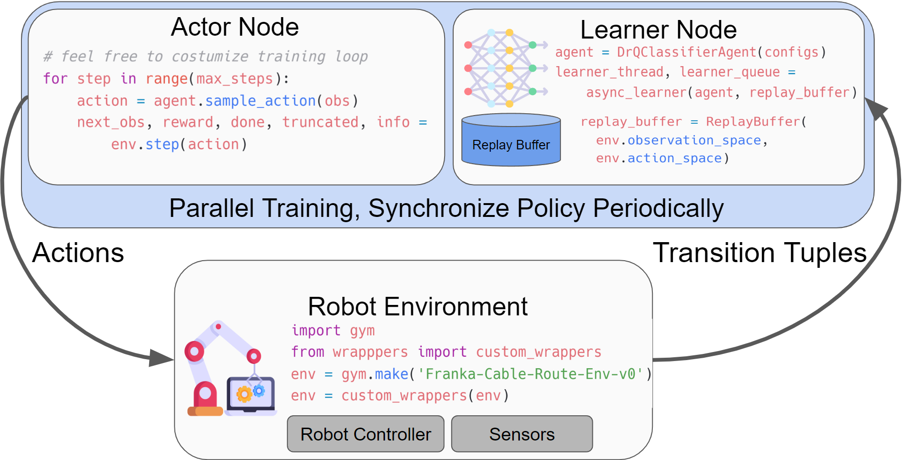

# AQI-HIL-SERL: Active and Quality-Aware Human-in-the-Loop RL for Operator-Robust Robotic Insertion

[](https://opensource.org/licenses/Apache-2.0)

This repository implements **AQI-HIL-SERL** — *Active and Quality-Aware
Intervention* human-in-the-loop reinforcement learning for operator-robust
robotic insertion — together with a **MuJoCo simulation** that runs the whole
collect → train → evaluate pipeline with no robot and no ROS. It builds on an
existing open-source human-in-the-loop RL framework and adds two contributions:

1. **AQI-HIL-SERL** — the robot *actively* decides when to request a human
   correction (from critic-ensemble uncertainty, predicted failure,
   force/torque risk and out-of-distribution novelty) and *scores the quality*
   of each correction before learning from it (quality-weighted replay priority
   and imitation loss, with hard force/torque safety vetoes). See the
   [AQI section](#aqi-hil-serl-active-and-quality-aware-intervention) and
   [docs/aqi_walkthrough.md](./docs/aqi_walkthrough.md).
2. **MuJoCo simulation** (`franka_sim`) — a Panda peg-insertion environment
   exposed through the same interface as the real-robot tasks, so the full
   pipeline runs with **no robot, no ROS, and no reward classifier**. See the
   [simulation section](#run-in-simulation-no-hardware) and
   [docs/sim_walkthrough.md](./docs/sim_walkthrough.md).

**Table of Contents**
- [Installation](#installation)
- [Overview and Code Structure](#overview-and-code-structure)
- [AQI-HIL-SERL (Active and Quality-Aware Intervention)](#aqi-hil-serl-active-and-quality-aware-intervention)
- [Run in Simulation (no hardware)](#run-in-simulation-no-hardware)
- [Run with the Franka Arm](#run-with-the-franka-arm)

> **New here?** Read [docs/getting_started.md](./docs/getting_started.md) — a
> no-background guide to understanding and running the operator-dependency
> study. For the methods in depth (how the synthetic operators are built, how
> operator-dependency is measured within-operator and within-method, and how the
> campaign works) see [docs/methods.md](./docs/methods.md).
>
> **Deep dives:** [docs/oracle_and_synthetic_operator.md](./docs/oracle_and_synthetic_operator.md)
> explains the oracle → synthetic-operator design (perception → decision → motor,
> where noise enters, the geometric vs policy oracle);
> [docs/operator_skill_assessment.md](./docs/operator_skill_assessment.md) explains
> how any operator — human or synthetic — is automatically typed by skill from its
> interaction logs;
> [docs/critic_ensemble.md](./docs/critic_ensemble.md) explains how the K critics
> are aggregated for the backup, the actor, and the AQI trigger — and now also
> documents the **structural tuning that makes the ensemble converge** (§7) and
> the **problems with the counterfactual-advantage quality score** (§4.2);
> [docs/dependency_analysis.md](./docs/dependency_analysis.md) gives the
> variance-decomposition mathematics (ICC, spread, permutation, bootstrap) in
> full; and [docs/architecture.md](./docs/architecture.md) maps which script
> writes and reads what.
>
> **Key empirical findings (read these):** the ensemble/quality results and the
> full reasoning behind every design change live in the thesis logs —
> [docs/thesis/rq3_structural_ablation_and_qa_log.md](./docs/thesis/rq3_structural_ablation_and_qa_log.md)
> (the default ensemble hurts), 
> [docs/thesis/rq4_ensemble_convergence_and_qa_log.md](./docs/thesis/rq4_ensemble_convergence_and_qa_log.md)
> (the structural fixes that recover it, §2/§7–§10, and the quality-score
> diagnostic + behavioral redesign, §11–§12), and
> [docs/thesis/rq2_quality_replay_and_qa_log.md](./docs/thesis/rq2_quality_replay_and_qa_log.md)
> (the original quality-replay critique). Start from `docs/critic_ensemble.md`
> §4.2 and §7, which summarise these and link into the logs.
>
> **Writing the thesis?** [docs/thesis/](./docs/thesis/) is the hub — the experiment
> plan, the exact run/analyse/plot protocols, a ready-to-run campaign config, and a
> chapter-by-chapter map from each RQ to the doc, command, and figure.
>
> **Learning the codebase?** [docs/learn/](./docs/learn/README.md) is a
> self-study course built around this repo:
> - where every algorithm and wrapper lives, with one training step traced end to end;
> - the algorithms from the maths to the code;
> - the libraries (JAX, Flax, Optax, Gymnasium, MuJoCo, agentlace), with runnable examples;
> - the Python features and design patterns used here;
> - graded exercises, and a guide to presenting and defending the thesis.

## Installation
1. **Setup Conda Environment:**
    create an environment with
    ```bash
    conda create -n hilserl python=3.10
    ```

2. **Install Jax as follows:**
    - For CPU (not recommended):
        ```bash
        pip install --upgrade "jax[cpu]"
        ```

    - For GPU:
        ```bash
        pip install --upgrade "jax[cuda12_pip]==0.4.35" -f https://storage.googleapis.com/jax-releases/jax_cuda_releases.html
        ```
        > Note: `jax==0.4.35` only supports GPU architectures up to Ada/Hopper. On newer GPUs (e.g. Blackwell, sm_120) install a recent CUDA JAX instead:
        > ```bash
        > pip install --upgrade "jax[cuda12]"   # jax>=0.11, pulls in matching CUDA 12 / cuDNN 9 wheels
        > ```
        > A newer JAX also requires `numpy>=2.1`, `flax>=0.10`, `tensorflow-cpu>=2.18`, and `scipy>=1.13` (already reflected in `serl_launcher/requirements.txt`).

    - For TPU
        ```bash
        pip install --upgrade "jax[tpu]" -f https://storage.googleapis.com/jax-releases/libtpu_releases.html
        ```
    - See the [Jax Github page](https://github.com/google/jax) for more details on installing Jax.

3. **Install the serl_launcher**
    ```bash
    cd serl_launcher
    pip install -e .
    pip install -r requirements.txt
    ```

4. **Install for serl_robot_infra** Follow the [README](./serl_robot_infra/README.md) in `serl_robot_infra` for installation and basic robot operation instructions. This contains the instruction for installing the impendence-based [serl_franka_controllers](https://github.com/rail-berkeley/serl_franka_controllers). After the installation, you should be able to run the robot server, interact with the gym `franka_env` (hardware).

    > If you only want to run **in simulation**, you can skip this step entirely — see [Run in Simulation](#run-in-simulation-no-hardware) below.

5. **(Optional) Install `franka_sim` for simulation** No robot or ROS required. This installs the MuJoCo Panda peg-insertion environment used by the `sim_peg_insertion` experiment.
    ```bash
    cd franka_sim
    pip install -e .
    pip install -r requirements.txt
    ```
    On a headless / CPU machine also set `export MUJOCO_GL=egl`. See [docs/sim_walkthrough.md](./docs/sim_walkthrough.md) for the full walkthrough.

    **On the RWTH cluster CLAIX** (Slurm, H100 nodes): see [cluster/claix/README.md](./cluster/claix/README.md) for a separate copy of the code, the environment setup, VS Code over SSH and campaign jobs.

## Overview and Code Structure

The training pipeline runs two asynchronous nodes — an **actor** and a
**learner** — that both interact with the robot (or simulation) gym environment.
Data flows from the actor to the learner over the network using
[agentlace](https://github.com/youliangtan/agentlace), and the learner
periodically synchronizes the updated policy back to the actor. This design
allows parallel training and inference.



**Table for code structure**

| Code Directory | Description |
| --- | --- |
| [examples](./examples/) | Scripts for policy training, demonstration data collection, reward classifier training |
| [serl_launcher](./serl_launcher/) | Main library (agents, wrappers, data, vision) |
| [serl_launcher.agents](./serl_launcher/serl_launcher/agents/) | Agent policies (e.g. SAC, BC) |
| [serl_launcher.wrappers](./serl_launcher/serl_launcher/wrappers/) | Gym env wrappers |
| [serl_launcher.data](./serl_launcher/serl_launcher/data/) | Replay buffer and data store |
| [serl_launcher.vision](./serl_launcher/serl_launcher/vision/) | Vision related models and utils |
| [serl_launcher.aqi](./serl_launcher/serl_launcher/aqi/) | **AQI extension:** active query gate + intervention-quality-aware replay/loss |
| [franka_sim](./franka_sim/) | **Simulation extension:** MuJoCo Panda peg-insertion env; run the whole pipeline with no hardware |
| [examples/experiments/sim_peg_insertion](./examples/experiments/sim_peg_insertion/) | **Simulation experiment:** config, wrappers and launch scripts for `--exp_name=sim_peg_insertion` |
| [examples/train_aqi_rlpd.py](./examples/train_aqi_rlpd.py) | **AQI training entry point:** adds `--aqi_mode`, active-trigger cues, ensemble/quality knobs |
| [examples/train_hiril.py](./examples/train_hiril.py) + [serl_launcher.hiril](./serl_launcher/serl_launcher/hiril/) | **External baseline HiRIL** (Zhou et al., ESWA 2026): separate pipeline, TD3 + Bayesian IQN critic, risk-triggered interventions, TDRD replay; see [docs/hiril_baseline.md](./docs/hiril_baseline.md) |
| [serl_launcher.agents.continuous.e2hil](./serl_launcher/serl_launcher/agents/continuous/e2hil.py) | **External baseline E2HiL** (Deng et al., RA-L 2026): `--aqi_mode=e2hil`, entropy-bounded actor loss; see [docs/e2hil_baseline.md](./docs/e2hil_baseline.md) |
| [serl_robot_infra](./serl_robot_infra/) | Robot infra for running with real robots |
| [serl_robot_infra.robot_servers](./serl_robot_infra/robot_servers/) | Flask server for sending commands to robot via ROS |
| [serl_robot_infra.franka_env](./serl_robot_infra/franka_env/) | Gym env for Franka robot |

## AQI-HIL-SERL (Active and Quality-Aware Intervention)

**AQI-HIL-SERL** targets operator-robust insertion: the robot actively requests
human intervention in informative/safety-critical states (critic-ensemble
uncertainty, predicted failure, force/torque risk, OOD novelty), and scores each
received intervention with a counterfactual advantage before using it for
learning (quality-weighted replay priority and imitation loss, with hard
force/torque safety vetoes and outcome filtering). Train with
`examples/train_aqi_rlpd.py --aqi_mode={hilserl,logged,active,quality,aqi}`; the
`hilserl` mode disables the extension and reproduces the baseline. See
[docs/aqi_walkthrough.md](./docs/aqi_walkthrough.md) for the method-to-code
map, run recipes, and the offline multi-operator analysis
(`examples/aqi_analysis.py`), and
[docs/experimental_protocol.md](./docs/experimental_protocol.md) for the
pre-registered operator-study pipeline (fixed evaluation ruler, session
run-book, dependency/comparison statistics, decision rules).

**Synthetic operators and automatic operator-skill assessment** (methodology
docs, Jul 2026): a graded, ground-truth-labelled operator generator
(perception -> decision -> motor model, SDT intervention gate, SpaceMouse-
equivalent wrapper) plus a Table-7 feature pipeline and Methods A-D that type
any operator from interaction logs. See
[docs/synthetic_operators_and_skill.md](./docs/synthetic_operators_and_skill.md);
drive training with `train_aqi_rlpd.py --synthetic_operator`, collect
demos with `examples/collect_synthetic_demos.py`, and assess with
`examples/operator_skill.py` / `experiment_pipeline.py assess`.

## Run in Simulation (no hardware)

This repository ships a **MuJoCo peg-insertion environment** (`franka_sim`) that
is exposed through the exact same interface as the real-robot tasks, so you can
run the entire AQI-HIL-SERL pipeline — demo collection, training and
evaluation — **without a Franka, without ROS, and without training a reward
classifier** (the simulator reports ground-truth success). It is the quickest
way to try the AQI extension end-to-end.

- **Environment package:** [franka_sim](./franka_sim/) — see its
  [README](./franka_sim/README.md) for the file map and every tunable
  parameter (tolerances, clearance, episode/reset time, randomization, cameras).
- **Experiment:** `--exp_name=sim_peg_insertion`
  ([examples/experiments/sim_peg_insertion](./examples/experiments/sim_peg_insertion/)).
  Two geometries are provided: `cylinder` (easy round peg) and `hex` (tight
  reference task requiring XY **and** yaw alignment).
- **Full walkthrough:** [docs/sim_walkthrough.md](./docs/sim_walkthrough.md)
  covers SpaceMouse teleoperation, recording demos, training with human
  takeovers, and running the AQI modes/analysis in sim.

Quick start (after installing `franka_sim`, see [Installation](#installation) step 5):

```bash
cd examples
source experiments/sim_peg_insertion/sim_env.sh

# 1. collect a few SpaceMouse demonstrations (live viewer on)
python record_demos.py --exp_name=sim_peg_insertion --render

# 2. train (baseline or any AQI mode); learner + actor in two shells
python train_aqi_rlpd.py --exp_name=sim_peg_insertion --learner --aqi_mode=hilserl
python train_aqi_rlpd.py --exp_name=sim_peg_insertion --actor   --aqi_mode=aqi --render
```

> VS Code users: the repo also ships click-to-run tasks (Terminal → Run Task…)
> for record / learner / actor / eval with dropdowns for the method
> (`baseline/logged/active/quality/combined`), geometry, and trigger/quality
> knobs.
