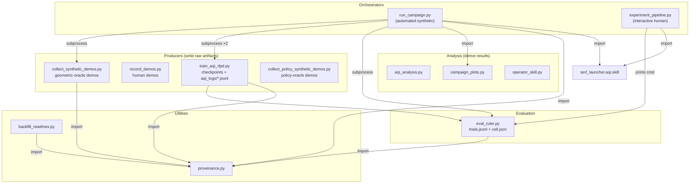

# Repository architecture and data flow

A map of **which script writes what**, **which script reads what**, and **how they
call each other** — so you can trace any result back to the artifact and the code
that produced it. This is the orientation document for the `examples/` pipeline;
for the *methods* behind it see [methods.md](methods.md), and for the AQI
algorithm see [aqi_walkthrough.md](aqi_walkthrough.md).

> **One-line mental model:** a handful of **producers** write raw artifacts
> (checkpoints, JSONL logs, demo `.pkl`s); **evaluation** scores frozen
> checkpoints on a fixed ruler; **analysis** scripts derive results from those
> artifacts; and two **orchestrators** wire the stages together for the two study
> types (automated-synthetic and interactive-human).

---

## 1. The five roles

### 1.1 Producers — write the raw artifacts

| script | writes |
|---|---|
| [`train_aqi_rlpd.py`](../examples/train_aqi_rlpd.py) | `runs/<task>_<mode>_<op>_s<seed>/` (checkpoints) and `aqi_logs/<run>/` (`steps.jsonl`, `segments.jsonl`, `episodes.jsonl`) |
| [`train_hiril.py`](../examples/train_hiril.py) | external HiRIL baseline (own learner): checkpoints + `agent_type.json`, `aqi_logs/<run>/` (`episodes.jsonl`, `segments.jsonl`); launched by `run_campaign.py` for arms with `mode: hiril` ([hiril_baseline.md](hiril_baseline.md)) |
| [`record_demos.py`](../examples/record_demos.py) | human (SpaceMouse) demos → `demo_data/<task>/human/` |
| [`collect_synthetic_demos.py`](../examples/collect_synthetic_demos.py) | **geometric-oracle** demos → `demo_data/<task>/synthetic/` |
| [`collect_policy_synthetic_demos.py`](../examples/collect_policy_synthetic_demos.py) | **policy-oracle** demos → `demo_data/<task>/policy/` |

### 1.2 Evaluation — score a frozen checkpoint

[`eval_ruler.py`](../examples/eval_ruler.py) reads a **checkpoint + `eval_grid.json`**
and writes `eval_runs/<cell>/trials.jsonl` + `cell.json`. It is the
operator-independent measuring stick (frozen policy, `argmax`, hash-locked grid —
see [eval_ruler.md](eval_ruler.md)). It is called as a **subprocess** by
`run_campaign.py`, and as a **printed command** by `experiment_pipeline.py` (the
human runs it).

### 1.3 Analysis — derive results from artifacts

| script | reads | writes | standalone? |
|---|---|---|---|
| [`aqi_analysis.py`](../examples/aqi_analysis.py) | `aqi_logs/` (JSONL only) | `summary.md`, `results.json`, 4 plots | **fully standalone** (imports no other script) |
| [`quality_signal_audit.py`](../examples/quality_signal_audit.py) | `aqi_logs/` (segments + episodes + meta; steps for PART C) | `report/quality_audit/{summary.md,audit.json,segments.csv}` + plots | yes (also called by `run_campaign.py analyze`); see [quality_signal_audit.md](quality_signal_audit.md) |
| [`campaign_plots.py`](../examples/campaign_plots.py) | `<campaign>/report/dependency.json` | `<campaign>/report/plots/*.png` | yes (also imported by `run_campaign.py`) |
| [`operator_skill.py`](../examples/operator_skill.py) | `aqi_logs/` or demo `.pkl` (via `serl_launcher.aqi.skill`) | `skill_report.md`, `skill.json` | yes (also driven by `experiment_pipeline.py assess`) |

### 1.4 Orchestrators — coordinate multiple stages

| script | study type | stages / subcommands | key point |
|---|---|---|---|
| [`run_campaign.py`](../examples/run_campaign.py) | **automated synthetic** | `sample → demos → train → eval → analyze` | calls `collect_synthetic_demos`, `train_aqi_rlpd` (×2), `eval_ruler` as **subprocesses**; imports `campaign_plots` + `provenance` + `serl_launcher.aqi.skill`. Has its **own** `analyze()` — does *not* call `aqi_analysis.py`. |
| [`experiment_pipeline.py`](../examples/experiment_pipeline.py) | **interactive human** | `init → session → evaluate → assess → simulate` | **prints** the `eval_ruler.py` command (not a subprocess); uses `serl_launcher.aqi.skill`/`stats` directly. Has its **own** `evaluate()` — does *not* call `aqi_analysis.py`; does *not* call `run_campaign.py`. |

### 1.5 Utilities

| script | role |
|---|---|
| [`provenance.py`](../examples/provenance.py) | writes `manifest.json` + `README.md` next to artifacts. Pure library (no `main()`); imported by `run_campaign`, `collect_synthetic_demos`, `eval_ruler`, `train_aqi_rlpd`, `backfill_readmes`. |
| [`backfill_readmes.py`](../examples/backfill_readmes.py) | scans existing artifacts and retrofits provenance; run manually on legacy data. |

---

## 2. Two orchestrators, two study types

The repo supports **two distinct studies**, and it matters which one produced a
result:

- **`run_campaign.py`** — the *fully automated synthetic* operator study. No human
  in the loop; the synthetic operator drives both demos and interventions. Used
  for the operator-dependency campaign (see [campaign_runner.md](campaign_runner.md)).
- **`experiment_pipeline.py`** — the *interactive human* study with a
  pre-registered protocol (freeze → session-per-operator → evaluate). Used for
  real-operator experiments (see [experimental_protocol.md](experimental_protocol.md)).

Both score policies on the **same** `eval_ruler.py`, so their SR numbers are
comparable; they differ in who supervises training and in how much is automated.

---

## 3. The three "success rate" levels (do not conflate)

Three analysis entry points report success rates that are **not the same
measurement**. Being explicit about which one a figure uses is essential:

| script | reads | SR used | what it means |
|---|---|---|---|
| [`aqi_analysis.py`](../examples/aqi_analysis.py) | `aqi_logs/` only | **training episode SR** — *online*, includes operator help | quick diagnostics: trigger calibration, intervention quality, learning curves |
| [`experiment_pipeline.py`](../examples/experiment_pipeline.py) | `aqi_logs/` + `eval_runs/` | **eval-ruler SR** — *frozen policy, autonomous, no operator* | formal human study with pre-registered protocol |
| [`run_campaign.py`](../examples/run_campaign.py) | orchestrates train + ruler + analysis | **eval-ruler SR** (same as pipeline) | fully automated synthetic study |

- **Online / training SR** (`aqi_analysis.py`) counts an episode as a success
  *even if the operator intervened* — it measures the human+robot team during
  learning. Great for diagnostics, wrong for the headline claim.
- **Autonomous / ruler SR** (`experiment_pipeline.py`, `run_campaign.py`) freezes
  the policy and runs it **without any operator** on the fixed grid. This is the
  number the operator-dependency decomposition
  ([dependency_analysis.md](dependency_analysis.md)) is computed on — "the policy
  no longer needs the operator."

The **convergence** criterion during training uses the *autonomous* notion too
(an episode only counts toward convergence if the operator never took over) —
consistent with the ruler. See [methods.md §3.6](methods.md).

---

## 4. Tracing a result back to its source

- A **plot in `<campaign>/report/plots/`** → `campaign_plots.py` ← `report/dependency.json`
  ← `run_campaign.py analyze` ← `eval_runs/<cell>/cell.json` ← `eval_ruler.py` ←
  the checkpoint in `checkpoints/<cell>/` ← `train_aqi_rlpd.py`.
- A **learning curve / trigger-calibration plot** → `aqi_analysis.py` ←
  `aqi_logs/<run>/*.jsonl` ← `train_aqi_rlpd.py`.
- A **skill report** → `operator_skill.py` (or `experiment_pipeline.py assess`) ←
  `serl_launcher.aqi.skill` ← `aqi_logs/` or a demo `.pkl`.
- Every artifact folder also carries a `manifest.json` + `README.md` from
  `provenance.py` describing the task, the conditions, and **which choices were
  inert** for that cell.

### See also

- [getting_started.md](getting_started.md) — the no-background walkthrough.
- [methods.md](methods.md) — the study design behind these scripts.
- [campaign_runner.md](campaign_runner.md) / [experimental_protocol.md](experimental_protocol.md)
  — the two orchestrators in depth.
- [eval_ruler.md](eval_ruler.md) — the fixed ruler.
- [aqi_analysis.md](aqi_analysis.md) — the offline training-log analysis.
