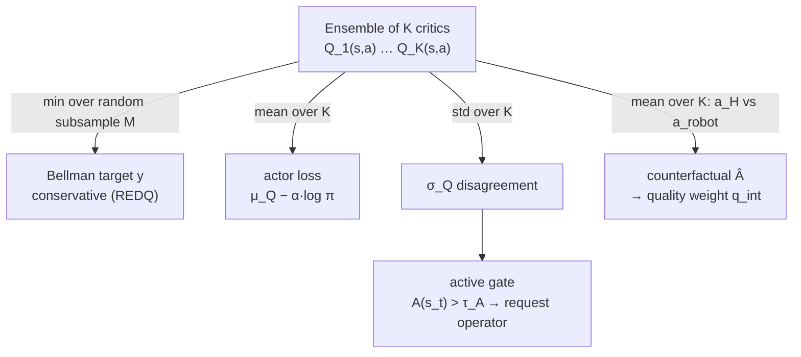

# The critic ensemble and Q-value aggregation

A deep-dive into **how many critics each mode trains** and **the three different
ways their Q-values are aggregated** — one for the critic backup, one for the
actor, and one for the AQI trigger. Getting this straight is essential for the
thesis: the *same* ensemble feeds conservative RL updates *and* the epistemic
uncertainty signal that decides when to ask the operator for help.

> **One-line mental model:** the ensemble is used **three times with three
> different reductions** — **min over a random subsample** for the Bellman
> target (conservative), **mean over all K** for the actor (optimistic enough to
> improve the policy), and **standard deviation over all K** for the trigger
> (disagreement = uncertainty).

Source of truth in code:

| concern | file |
|---|---|
| critic defaults, per-mode switches, `AQIConfig` | [`serl_launcher/serl_launcher/aqi/config.py`](../serl_launcher/serl_launcher/aqi/config.py) |
| critic target / actor loss math | [`serl_launcher/serl_launcher/agents/continuous/sac.py`](../serl_launcher/serl_launcher/agents/continuous/sac.py) (and `sac_hybrid_single.py`, `sac_hybrid_dual.py`) |
| ensemble plumbing (K, subsample, bootstrap) | [`serl_launcher/serl_launcher/utils/launcher.py`](../serl_launcher/serl_launcher/utils/launcher.py), [`serl_launcher/serl_launcher/data/replay_buffer.py`](../serl_launcher/serl_launcher/data/replay_buffer.py) |
| $\sigma_Q$, $\mu_Q$, counterfactual advantage | [`serl_launcher/serl_launcher/aqi/uncertainty.py`](../serl_launcher/serl_launcher/aqi/uncertainty.py) |
| active gate / quality scorer | [`serl_launcher/serl_launcher/aqi/query_gate.py`](../serl_launcher/serl_launcher/aqi/query_gate.py), [`serl_launcher/serl_launcher/aqi/quality.py`](../serl_launcher/serl_launcher/aqi/quality.py), [`serl_launcher/serl_launcher/aqi/runtime.py`](../serl_launcher/serl_launcher/aqi/runtime.py) |

---

## 1. How many critics does each mode train?

`--aqi_mode` sets the ensemble size $K$ and whether the extra machinery
(requesting, quality) is active. Everything else is identical between modes so
the comparison is controlled.

| mode | critics $K$ | TD target | active gate ($\sigma_Q$) | quality-weighted replay/loss |
|---|---|---|---|---|
| `hilserl` (baseline) | **2, fixed** | min over the 2 target critics (twin-critic SAC) | – | – |
| `logged` | **10** (default) | REDQ min over a random subsample (default 2) | – | – |
| `active` | **10** | REDQ min over a subsample | ✓ uncertainty (+ selected terms) | – |
| `quality` | **10** | REDQ min over a subsample | – (requests suppressed) | ✓ counterfactual advantage |
| `aqi` (full) | **10** | REDQ min over a subsample | ✓ | ✓ |

Notes for precise wording:

- **`hilserl` is exactly the twin-critic min backup** — two critics, always both,
  no subsampling. The "sample-then-min" idea below applies only to the ensemble
  modes (`logged`, `active`, `quality`, `aqi`).
- **`active`-only still means $K=10$.** "Uncertainty-only trigger" is a choice of
  `trigger_terms=("uncertainty",)` *within* `active` mode — the ensemble size is
  unchanged; only which terms feed the gate changes.
- The knobs are `critic_ensemble_size` ($K$, default 10 for non-`hilserl`) and
  `critic_subsample_size` ($M$, default 2) in
  [`config.py`](../serl_launcher/serl_launcher/aqi/config.py).

> **These defaults were found to HURT on the cuboid task** (the ensemble lowers
> success and raises operator-dependence vs plain `hilserl`). See
> [§7](#7-structural-tuning--making-the-logged-ensemble-converge-rq4) for the
> problem, root cause (min-Q pessimism), and the fix ($M{:}2\to1$, $K{:}10\to8$,
> warm-start, lower LR) that recovers parity.

---

## 2. Use #1 — the Bellman backup: min over a random subsample (REDQ)

The critics are trained toward a **conservative** TD target. With an ensemble of
$K$ target critics $\{Q^{\text{targ}}_i\}_{i=1}^{K}$, each update draws a random
subset $\mathcal{S}\subseteq\{1,\dots,K\}$ of size $M$ and takes the **minimum**
over that subset:

$$
y \;=\; r \;+\; \gamma\,(1-d)\,\min_{i\in\mathcal{S}} Q^{\text{targ}}_i(s',a'),
\qquad a'\sim\pi(\cdot\mid s'),\;\; |\mathcal{S}|=M .
$$

This is the **REDQ** target construction (see [§6](#6-what-redq-means-and-where-it-comes-from)):
keep a large ensemble, but back up against the min of a small random subset.
The min deliberately **underestimates** $Q$, which counteracts the
overestimation bias of bootstrapped value learning; drawing a fresh subset each
step is cheaper than a full min over all $K$ and injects extra target
stochasticity.

> **Caveat (empirical):** on cuboid insertion this min-Q pessimism *under-values
> the risky "press into contact" action* and blocks autonomous convergence.
> Setting $M=1$ (a single random critic, no min) removes it — the main RQ4 fix
> ([§7.2](#72-root-cause--redq-min-q-pessimism)).

In [`sac.py`](../serl_launcher/serl_launcher/agents/continuous/sac.py) the target
is exactly this subsample-min (with a per-member variant, see below):

```python
n_sub = self.config["critic_subsample_size"]           # M (default 2)
subsample_idcs = jax.random.randint(subsample_key,
        (n_ens, n_sub) if per_member else (n_sub,), 0, n_ens)
target_next_min_q = target_next_qs[subsample_idcs].min(axis=1 if per_member else 0)
target_q = batch["rewards"] + discount * batch["masks"] * target_next_min_q
```

- `hilserl` ($K=2$, no subsample flag) reduces to `target_next_qs.min(axis=0)` —
  the ordinary twin-critic min.
- **Per-member targets** (`critic_per_member_targets`, default on for the
  ensemble modes): each member draws its *own* independent min-subsample, so
  targets are **decorrelated** across members. That is what keeps the
  disagreement $\sigma_Q$ a meaningful *epistemic* signal instead of collapsing
  every member onto one shared REDQ target.

### 2.1 Why the ensemble members see different data

For $\sigma_Q$ to measure *epistemic* uncertainty the members must be trained on
*different* data, not just different initializations. Every replay buffer stores a
**persistent** Bernoulli(`critic_bootstrap_p`, default 0.8) mask per
`(transition, member)`, drawn once at insertion
([`replay_buffer.py`](../serl_launcher/serl_launcher/data/replay_buffer.py)), and
member $i$'s TD loss is weighted by its mask:

$$
\mathcal{L}_{\text{critic}}
= \frac{\sum_{i,b} m_{i,b}\,\big(Q_i(s_b,a_b)-y_b\big)^2}
       {\sum_{i,b} m_{i,b}},
\qquad m_{i,b}\sim\text{Bernoulli}(p).
$$

Persistence matters: resampling masks every update over a stream of fresh data is
statistically a no-op, which is why the mask lives *in the buffer with the
transition*. The shared-data ablation `--bootstrap_p=1.0
--per_member_targets=false` recovers the init-diversity-only "deep ensembles"
variant; `hilserl` ignores both.

---

## 3. Use #2 — the actor loss: mean over all K

The policy is improved against the **mean** Q across *all* $K$ critics — not the
min. In [`sac.py`](../serl_launcher/serl_launcher/agents/continuous/sac.py):

```python
predicted_q = predicted_qs.mean(axis=0)                 # mean over K critics
actor_loss  = -jnp.mean(predicted_q - temperature * log_probs)
```

$$
\mathcal{L}_{\text{actor}}
= -\,\mathbb{E}_{s\sim\mathcal{D},\,a\sim\pi_\phi(\cdot\mid s)}
\Big[\; \underbrace{\tfrac{1}{K}\textstyle\sum_{i=1}^{K} Q_i(s,a)}_{\mu_Q(s,a)}
\;-\; \alpha\,\log\pi_\phi(a\mid s)\;\Big].
$$

The mean is **less pessimistic** than the min: the actor should chase genuinely
high-value actions, so aggregating with the mean (while the *critics* stay
conservative via the min-backup) balances "optimistic enough to improve" against
"conservative enough not to exploit overestimation."

| | reduction | rationale |
|---|---|---|
| critic / Bellman target | **min** over random subsample of $M$ | conservative; kills overestimation bias (REDQ) |
| actor gradient | **mean** over all $K$ | less pessimistic; steer policy toward high-value actions |
| trigger $\sigma_Q$ | **std** over all $K$ | measures ensemble disagreement = epistemic uncertainty |

---

## 4. Use #3 — the trigger and quality signals (no gradients)

The *same* forward pass over the ensemble yields the summary statistics AQI uses
to decide **when to ask for help** and **how much to trust a correction**. These
never enter a gradient update — they only drive the gate and the replay/loss
weights ([`uncertainty.py`](../serl_launcher/serl_launcher/aqi/uncertainty.py)):

$$
\mu_Q(s,a)=\frac1K\sum_{i=1}^{K}Q_i(s,a),
\qquad
\sigma_Q(s,a)=\operatorname{std}_i\big(Q_i(s,a)\big).
$$

- **Active gate (requesting).** $\sigma_Q$ is the epistemic-uncertainty term of the
  acquisition score $A(s_t)$ (optionally combined with failure / force / OOD /
  cost terms). The robot requests intervention when $A(s_t)>\tau_A$. See
  [aqi_walkthrough.md](aqi_walkthrough.md) §1 and §3 for the full $A(s_t)$.
- **Quality scoring (usage).** Each received intervention segment is scored by the
  **counterfactual advantage** — how much better the operator's action $a_H$ was
  than what the robot would have done $a_{\text{robot}}$, as judged by the mean
  critic:

$$
\hat{A}(s,a_H)=\mu_Q(s,a_H)-\mu_Q(s,a_{\text{robot}}),
\qquad
q_{\text{int}}=\operatorname{clip}(\hat{A},0,\infty)\cdot g(\sigma_Q).
$$

  $q_{\text{int}}$ becomes the replay priority and imitation weight; the
  disagreement gate $g(\sigma_Q)$ down-weights corrections scored under high
  ensemble disagreement (unreliable $\hat A$). A jumpy/novice operator produces
  many low- or negative-$\hat A$ takeovers, which the quality gate discounts —
  exactly the contrast the study is built to measure.

> The batched counterfactual over a whole intervention segment × $K$ critics is
> the one unbounded GPU allocation in the actor; it is chunked and OOM-guarded in
> [`uncertainty.py`](../serl_launcher/serl_launcher/aqi/uncertainty.py)
> (`counterfactual_advantage_batch_safe`). See
> [aqi_analysis.md](aqi_analysis.md) and the runtime notes.

### 4.1 The two consumers of `q_int` — simultaneous, independently ablatable

In `quality`/`aqi` the same $q_{\text{int}}$ drives **both** downstream uses **at
once** — they are *not* an either/or choice:

- **(A) prioritised replay** — the intervention/demo buffer
  ([`QualityAwareReplayBufferDataStore`](../serl_launcher/serl_launcher/data/data_store.py))
  samples transition $i$ with probability $\propto p_i$, where
  $$p_i=\big(\varepsilon+|\delta_i|+\eta\max(q_{\text{int}},0)\big)^{\alpha}.$$
  Good corrections are **drawn more often** for every gradient update. This changes
  sampling *frequency* only — there is **no importance-sampling re-weighting** of the
  RL loss.
- **(B) weighted BC** — the actor objective gains
  $\lambda_{\text{BC}}\,\dfrac{\sum_i w_i\,\mathrm{NLL}_i}{\sum_i w_i}$ with
  $w_i=\operatorname{clip}(\sigma(\gamma\tilde q),w_{\min},w_{\max})$ (and $w_i=0$ when
  $\hat A<a_{\text{excl}}$), so good corrections are **imitated more strongly** and
  harmful ones not at all.

Both are on together whenever `quality_on` (i.e. `quality` and `aqi`), but each is
**independently ablatable** — exactly how the S6.4 ablations isolate them:

| knob (default) | effect |
|---|---|
| `bc_loss_weight` (0.1) | `0` ⇒ **(B) off**, replay-only |
| `per_eta` (1.0) | `0` ⇒ drop the quality bonus in $p_i$ (plain PER) |
| `priority_sampling` (True) | `False` ⇒ **(A) off**, uniform replay, BC-only |
| `quality_disagreement_gate` (True) | toggles $g(\sigma_Q)$ on $q_{\text{int}}$ |
| `adv_exclude` (0.0) | $\hat A$ below this ⇒ $w_i=0$ (harmful excluded) |
| `use_td_priority` (False) | if `True`, learner refreshes $|\delta_i|$ into $p_i$ |

With `use_td_priority=False` (default) the $|\delta_i|$ term is a constant, so the
replay priority is effectively driven by **quality** $q_{\text{int}}$, not TD-error.

### 4.2 Known problems with the counterfactual-advantage score (important)

The counterfactual-advantage score
$$\hat A(s,a_H)=\mu_Q(s,a_H)-\mu_Q(s,a_{\text{robot}}),\qquad
q_{\text{int}}=\operatorname{clip}(\hat A,0,\infty)\cdot g(\sigma_Q),\qquad
p_i=\big(\varepsilon+|\delta_i|+\eta\,q_{\text{int}}\big)^{\alpha}$$
is **the AQI quality design as originally implemented**, and an extensive audit
found it **does not work on this task** — it is not merely weak but *anti-aligned*
with intervention value. This is a central negative result of the thesis; full
evidence in
[thesis/rq4_ensemble_convergence_and_qa_log.md](thesis/rq4_ensemble_convergence_and_qa_log.md)
§11–§12, [thesis/rq2_quality_replay_and_qa_log.md](thesis/rq2_quality_replay_and_qa_log.md)
§7/§10/§16/§18, and the leakage audit in
[thesis/handoff_evaluation_and_next_steps.md](thesis/handoff_evaluation_and_next_steps.md)
§2–§4. The flaws fall into three groups.

#### A. Flaws in the signal itself (the numerator $\hat A$)

1. **Single-sample, high-variance baseline (the action it compares against).**
   $a_{\text{robot}}$ is **one action randomly sampled** from the stochastic policy
   $\pi(\cdot\mid s)$ — not the mean or the argmax. So $\hat A$ compares the
   operator's action against a *single noisy draw*, and its value is dominated by
   *which* $a_{\text{robot}}$ happened to be sampled rather than by how good $a_H$
   is. The correct baseline is the state value
   $V(s)=\mathbb{E}_{a\sim\pi}[\mu_Q(s,a)]$ (or the argmax action); a one-sample
   estimate of it has high variance and no bias control. This alone makes
   $\hat A$ a noisy estimator of the true advantage.
2. **Off-distribution critic evaluation (the main structural flaw).** $a_H$ is
   *off-distribution* — the policy never takes it, so the off-policy critic has no
   training signal there and **systematically under-values** $\mu_Q(s,a_H)$. Measured:
   $\hat A<0$ for **~64 %** of intervention steps — the critic rates its *own*
   action above the human correction. The critic is only trustworthy *on* its own
   distribution, which is exactly where $a_H$ is not.
3. **Tiny magnitude in sparse-reward units.** $\hat A$ is a *one-step* Q-difference
   between two nearby actions at the same state; with sparse 0/1 reward the Q-values
   are small and the difference is smaller still — measured $q_{\text{int}}\sim10^{-3}$
   (median 0, mean $\approx5\!\times\!10^{-4}$). At a given state two reasonable
   actions have almost identical Q, so the signal is near-zero by construction.
4. **One-step and per-state, not per-outcome.** $\hat A$ scores the action at the
   instant of takeover; it says nothing about whether the intervention actually
   *changed the trajectory* (did the peg get inserted?). The informative label —
   the outcome after the takeover — is exactly what it does not use.
5. **Clipping throws away the majority of the data and the sign.**
   $q_{\text{int}}=\max(\hat A,0)$ discards the ~64 % negative steps, so a *harmful*
   intervention cannot be pushed below baseline, and the surviving ~36 % positives
   are a **biased, noisy subset** (the tail where the single $a_{\text{robot}}$ draw
   happened to be bad).
6. **Circularity / self-selection.** The critic being trained produces the score
   that selects its *own* training data (a feedback loop), and early in training the
   ensemble is noise — so the earliest, most influential priorities are driven by an
   untrained critic.
7. **Independent of critic quality.** Re-running on the **RQ4-fixed** ensemble
   (converged, operator-independent) left $q_{\text{int}}$ unchanged (still
   $\sim10^{-3}$, skill-blind, AUROC still $\approx0.18$). The defect is **intrinsic
   to the formulation**, not a symptom of a bad critic.

#### B. Flaws in how the score is *used* (priority denominator + gate)

8. **Buried by the additive floor.** In $p_i=(\varepsilon+|\delta|+\eta q)^{\alpha}$
   with `use_td_priority=False` the term $|\delta|$ is frozen at
   `per_delta_init`$=1.0$, so $\eta q\sim10^{-3}$ is lost inside $(1.05+q)^{0.6}$ —
   the realised replay boost was $\le\mathbf{1.03\times}$ (effectively **inert**).
9. **The standardisation *denominator* is tiny, noisy and non-stationary (the
   "small values / denominator" flaw).** The `per_standardize` remedy divides $q$ by
   a running scale $s=\overline{q_{+}}$ (the mean of positive $q$). But that
   denominator is itself $\sim10^{-3}$, estimated from the same clipped, noisy tail;
   it is **polluted by immature-critic noise early**, **drifts** as the critic
   changes, and (without an EMA) **never forgets**. Dividing a tiny, noisy numerator
   by a tiny, noisy denominator, $q/s$, is an **unstable ratio** — it can blow a
   meaningless $10^{-3}$ fluctuation up to an $O(1)$ "priority" purely from
   denominator noise, and is not reproducible across seeds / insertion orders. So
   the rescaling does not recover information; it mostly launders noise.
10. **$\alpha$-compression + no importance-sampling correction.** The exponent
    $\alpha=0.6$ compresses whatever spread survives, while the aggressive priorities
    it *does* produce **bias the value target** because there is no IS ($\beta$)
    re-weighting of the RL loss by default — strong prioritisation of a bad signal is
    worse than uniform.
11. **The disagreement gate $g(\sigma_Q)$ is relative, un-warmed, and possibly
    inverted.** $g(\sigma_Q)=1/\!\big(1+(\sigma_Q/\sigma_{\text{ref}})^2\big)$ with
    $\sigma_{\text{ref}}=\overline{\sigma_Q}$ (running mean), so $g\approx0.5$ on
    average and it **cannot** detect a *globally* immature ensemble (there is no
    warm-up on the quality path). Worse, the audit found $\sigma_Q$ *positively*
    associated with success — so the gate, which **down**-weights high $\sigma_Q$,
    may be pointing the **wrong way**.

#### C. Empirical verdicts

- **Anti-predictive.** AUROC$(q_{\text{int}},\text{episode success})=\mathbf{0.175}$
  — far *below* 0.5 — so prioritising replay by $q_{\text{int}}$ preferentially
  up-weights interventions from **failed** episodes. In training, `quality` was the
  **worst** arm (RQ3: SR 50.9 % vs 84 % baseline, ICC 0.887, paired $p=0.006$).
- **Not rescuable by a healthy critic** (flaw 7), nor by any **monotone rescaling**
  (flaws 8–10) — a rescale cannot create discrimination that is not in the raw signal.
- **The "fix" attempts and their verdicts.** Standardisation + warm-up + EMA + IS +
  refresh (RQ2 §18) removed the *instability* but not the inertness. A critic-free
  **behavioral** redesign looked promising live (AUROC 0.78) **but the leakage audit
  overturned it**: on the leakage-clean subset it is **0.499 (a coin flip)** — the
  apparent signal was takeover-*timing* leakage, not quality (handoff doc §2). So
  **no replay-priority intervention score survives** the controls; the counterfactual
  is the worst (inverted), the others are leakage / difficulty / noise.
- **The one survivor** is **ensemble disagreement $\sigma_Q$** (leakage-clean AUROC
  **0.849**), which is the *active-gate* trigger, not a quality score — hence the
  pivot to the active part.

> **Takeaway for the thesis.** Counterfactual-advantage intervention scoring is
> flawed on both sides of the subtraction: it compares the operator's action to a
> **single random policy sample** (not the value baseline), and it evaluates the
> operator's **off-distribution** action under an off-policy critic — yielding a
> signal that is tiny, mostly negative, and anti-aligned with outcome. Dividing that
> tiny signal by an equally tiny, noisy **denominator** does not rescue it. The defect
> is in the **numerator and the baseline**, independent of critic quality or
> rescaling; the signal is salvageable only by changing *what is measured* (an
> outcome/return-based advantage), and even the behavioral surrogate failed a leakage
> audit. The only intervention-time signal that survives is $\sigma_Q$.

---

## 5. End-to-end: one update step



---

## 6. What "REDQ" means and where it comes from

**REDQ** = *Randomized Ensembled Double Q-learning* (Chen et al., ICLR 2021). Its
core idea, borrowed here for the **target construction**, is:

1. keep an ensemble of $K$ critics;
2. for each TD target, sample a small random subset of size $M$;
3. back up against the **min** over that subset.

So instead of the fixed twin-critic min of SAC, you do a **random-subset min**
from a larger ensemble. In this repo:

- $K=$ `critic_ensemble_size` (default 10 for non-`hilserl` modes),
- $M=$ `critic_subsample_size` (default 2),
- the target is the subset-min at every update step.

Intuition: a **larger $K$** gives a better disagreement/uncertainty signal
$\sigma_Q$; a **small $M$** min keeps the target conservative (reduces
overestimation); and sampling is cheaper than a full min over all $K$. "REDQ-
style" here refers specifically to that target-update pattern (random subset +
min) sitting on top of the ensemble — the rest of the pipeline (actor mean,
$\sigma_Q$ trigger, counterfactual quality) is this project's own.

---

## 7. Structural tuning — making the `logged` ensemble converge (RQ4)

The per-mode defaults in [§1](#1-how-many-critics-does-each-mode-train)
($K=10$, $M=2$, per-member targets, bootstrap 0.8) are the **as-designed** REDQ
ensemble. An empirical study found that, on the cuboid peg-insertion task, this
default ensemble (`logged`) **hurts** relative to plain 2-critic `hilserl`, and a
targeted set of changes **recovers it to parity**. This section documents what was
changed and *why*; full results in
[docs/thesis/rq4_ensemble_convergence_and_qa_log.md](thesis/rq4_ensemble_convergence_and_qa_log.md).

### 7.1 The problem (RQ3)

With the defaults, `logged` (10-critic, uniform replay, no quality) vs plain
`hilserl` (2-critic):

| metric | `hilserl` (plain) | `logged` (default K10/M2) |
|---|---|---|
| mean autonomous SR | 86.7 % | **68.2 %** (−18.5 pp) |
| operator-dependence ICC | 0.027 | **0.743** |
| cells converged | 12/12 | **7/12 (58 %)** |

So the ensemble both **lowers success** and makes the outcome **strongly
operator-dependent**, and ~40 % of runs never reach the autonomous-success bar.

### 7.2 Root cause — REDQ min-Q pessimism

Insertion requires the policy to **press into contact** — a *risky* action. The
conservative **min-over-$M$ target** ([§2](#2-use-1--the-bellman-backup-min-over-a-random-subsample-redq))
systematically **under-values** that action (the worst-case critic in the subset
dominates the backup), so the policy avoids it, hovers, and never inserts
autonomously. The effect is worst for low-skill operators (more/longer
interventions, noisier critic), which is exactly why the **operator-dependence**
(ICC) explodes. A cold random-init ensemble and a high learning rate compound the
instability (the policy oscillates 0↔100 % between checkpoints).

### 7.3 The changes (before → after → why)

Only the `logged`/ensemble arm is changed; `hilserl` stays the untouched 2-critic
baseline. `critic_*` are mode-gated off for `hilserl`; `demo_pretrain` /
`learning_rate` are applied per-arm via the `method_overrides` campaign mechanism
so the baseline remains truly plain.

| parameter | default (RQ3) | **RQ4 fixed** | why |
|---|---|---|---|
| **$M$** `critic_subsample_size` | 2 (min of 2) | **1** (single random critic, **no min**) | *the key lever* — removes the min-Q pessimism that suppresses the "press" action |
| **$K$** `critic_ensemble_size` | 10 | **8** | mild; less compute/GPU + a slightly smaller subsample pool, still a genuine ensemble |
| `learning_rate` | 3e-4 | **1.5e-4** | damp the 0↔100 % checkpoint oscillation (smaller steps overshoot less) |
| `demo_pretrain(_steps)` | off (0) | **5000** | warm-start the cold ensemble on demos so it attempts insertion from step 1 |
| `critic_per_member_targets` | True | True (kept) | decorrelated targets keep $\sigma_Q$ epistemic |
| `critic_bootstrap_p` | 0.8 | 0.8 (kept) | per-member data diversity (bagging) |

With **$M=1$ and per-member targets**, each of the $K$ critics backs up against
**one independently-chosen member** — maximal decorrelation *and* no min-pessimism
(the `min` is over a single element, i.e. identity).

### 7.4 The result (RQ4)

The fixed 8-critic ensemble recovers to **statistical parity** with plain
HIL-SERL:

| metric | `hilserl` (plain) | `logged` default (RQ3) | **`logged` fixed (RQ4)** |
|---|---|---|---|
| mean autonomous SR | 84.2 % | 68.2 % | **82.3 %** (paired $p=0.30$, tie) |
| operator-dependence ICC | 0.000 | 0.743 | **0.000** (dependence eliminated) |
| cells converged | 16/18 | 7/12 | **16/18 (89 %)** |

So the ensemble's operator-dependence and non-convergence were **fixable** (an
artifact of min-Q pessimism + cold start + high LR), **not intrinsic** to using a
critic ensemble — the fixed ensemble even beats plain HIL-SERL on expert /
intermediate operators (remaining weakness: novice stability). *Attribution
caveat:* four factors changed at once; $M{:}2\to1$ is the prime suspect but a
one-factor sweep is future work.

### 7.5 New knobs added for this study

- `--critic_subsample_size` (train + campaign) — independent $M$ override (was
  previously coupled to $K$); clamped to $M\le K$.
- `--quality_score_mode {counterfactual,behavioral}` (see [§4.2](#42-known-problems-with-the-counterfactual-advantage-score-important)).
- `method_overrides:` (campaign YAML) — per-arm overrides so a baseline can opt
  out of a campaign-wide fix (e.g. keep `hilserl` un-pretrained).

---

## 8. Quick reference

- **`hilserl` = 2 critics, twin-critic min, no subsample.** Ensemble modes
  (`logged`/`active`/`quality`/`aqi`) = $K=10$, $M=2$ random-subset min (REDQ).
- **Three aggregations:** min-of-subsample (critic target), mean (actor),
  std (trigger $\sigma_Q$).
- **`active`-only is still $K=10$** — uncertainty-only is a `trigger_terms`
  choice, not a smaller ensemble.
- **Per-member targets + persistent bootstrap masks** decorrelate the members so
  $\sigma_Q$ is genuinely epistemic.
- **$\sigma_Q$ and $\hat A$ carry no gradients** — they drive the request gate and
  the quality-weighted replay/loss only.

### See also

- [aqi_walkthrough.md](aqi_walkthrough.md) — the full acquisition score $A(s_t)$,
  the quality module, and the composable trigger/quality ablations.
- [methods.md](methods.md) — how the modes are used in the operator-dependency
  study.
- [dependency_analysis.md](dependency_analysis.md) — how the trained policies are
  compared.

### Where the evidence lives (reading guide)

Read these in order for the full ensemble + quality-score story:

1. **[thesis/rq3_structural_ablation_and_qa_log.md](thesis/rq3_structural_ablation_and_qa_log.md)** —
   proves the *default* 10-critic ensemble hurts (SR −18.5 pp, ICC 0.03→0.74) and
   that quality replay hurts most; motivates §4.2 and §7 here.
2. **[thesis/rq4_ensemble_convergence_and_qa_log.md](thesis/rq4_ensemble_convergence_and_qa_log.md)** —
   the **structural fixes** (§2, §9 before→after tables = source for §7 here), the
   result (§10), the quality-signal diagnostic (§11), and the **behavioral score
   redesign** (§12 = source for §4.2 here).
3. **[thesis/rq2_quality_replay_and_qa_log.md](thesis/rq2_quality_replay_and_qa_log.md)** —
   the original quality-replay investigation, the "negligible score" diagnosis,
   and the full critique (§7/§10/§16/§18).
4. **[quality_signal_audit.md](quality_signal_audit.md)** — the AUROC/audit tooling
   used to reach the §4.2 verdict.
