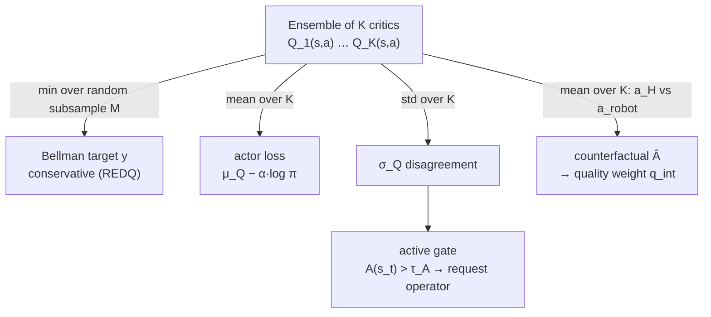

# The critic ensemble and Q-value aggregation

A deep-dive into **how many critics each mode trains** and **the three different
ways their Q-values are aggregated** — one for the critic backup, one for the
actor, and one for the AQI trigger. Getting this straight is essential for the
thesis: the *same* ensemble feeds conservative RL updates *and* the epistemic
uncertainty signal that decides when to ask the operator for help.

> **One-line mental model:** the ensemble is used **three times with three
> different reductions** — **min over a random subsample** for the Bellman
> target (conservative), **mean over all K** for the actor (optimistic enough to
> improve the policy), and **standard deviation over all K** for the trigger
> (disagreement = uncertainty).

Source of truth in code:

| concern | file |
|---|---|
| critic defaults, per-mode switches, `AQIConfig` | [`serl_launcher/serl_launcher/aqi/config.py`](../serl_launcher/serl_launcher/aqi/config.py) |
| critic target / actor loss math | [`serl_launcher/serl_launcher/agents/continuous/sac.py`](../serl_launcher/serl_launcher/agents/continuous/sac.py) (and `sac_hybrid_single.py`, `sac_hybrid_dual.py`) |
| ensemble plumbing (K, subsample, bootstrap) | [`serl_launcher/serl_launcher/utils/launcher.py`](../serl_launcher/serl_launcher/utils/launcher.py), [`serl_launcher/serl_launcher/data/replay_buffer.py`](../serl_launcher/serl_launcher/data/replay_buffer.py) |
| $\sigma_Q$, $\mu_Q$, counterfactual advantage | [`serl_launcher/serl_launcher/aqi/uncertainty.py`](../serl_launcher/serl_launcher/aqi/uncertainty.py) |
| active gate / quality scorer | [`serl_launcher/serl_launcher/aqi/query_gate.py`](../serl_launcher/serl_launcher/aqi/query_gate.py), [`serl_launcher/serl_launcher/aqi/quality.py`](../serl_launcher/serl_launcher/aqi/quality.py), [`serl_launcher/serl_launcher/aqi/runtime.py`](../serl_launcher/serl_launcher/aqi/runtime.py) |

---

## 1. How many critics does each mode train?

`--aqi_mode` sets the ensemble size $K$ and whether the extra machinery
(requesting, quality) is active. Everything else is identical between modes so
the comparison is controlled.

| mode | critics $K$ | TD target | active gate ($\sigma_Q$) | quality-weighted replay/loss |
|---|---|---|---|---|
| `hilserl` (baseline) | **2, fixed** | min over the 2 target critics (twin-critic SAC) | – | – |
| `logged` | **10** (default) | REDQ min over a random subsample (default 2) | – | – |
| `active` | **10** | REDQ min over a subsample | ✓ uncertainty (+ selected terms) | – |
| `quality` | **10** | REDQ min over a subsample | – (requests suppressed) | ✓ counterfactual advantage |
| `aqi` (full) | **10** | REDQ min over a subsample | ✓ | ✓ |

Notes for precise wording:

- **`hilserl` is exactly the twin-critic min backup** — two critics, always both,
  no subsampling. The "sample-then-min" idea below applies only to the ensemble
  modes (`logged`, `active`, `quality`, `aqi`).
- **`active`-only still means $K=10$.** "Uncertainty-only trigger" is a choice of
  `trigger_terms=("uncertainty",)` *within* `active` mode — the ensemble size is
  unchanged; only which terms feed the gate changes.
- The knobs are `critic_ensemble_size` ($K$, default 10 for non-`hilserl`) and
  `critic_subsample_size` ($M$, default 2) in
  [`config.py`](../serl_launcher/serl_launcher/aqi/config.py).

---

## 2. Use #1 — the Bellman backup: min over a random subsample (REDQ)

The critics are trained toward a **conservative** TD target. With an ensemble of
$K$ target critics $\{Q^{\text{targ}}_i\}_{i=1}^{K}$, each update draws a random
subset $\mathcal{S}\subseteq\{1,\dots,K\}$ of size $M$ and takes the **minimum**
over that subset:

$$
y \;=\; r \;+\; \gamma\,(1-d)\,\min_{i\in\mathcal{S}} Q^{\text{targ}}_i(s',a'),
\qquad a'\sim\pi(\cdot\mid s'),\;\; |\mathcal{S}|=M .
$$

This is the **REDQ** target construction (see [§6](#6-what-redq-means-and-where-it-comes-from)):
keep a large ensemble, but back up against the min of a small random subset.
The min deliberately **underestimates** $Q$, which counteracts the
overestimation bias of bootstrapped value learning; drawing a fresh subset each
step is cheaper than a full min over all $K$ and injects extra target
stochasticity.

In [`sac.py`](../serl_launcher/serl_launcher/agents/continuous/sac.py) the target
is exactly this subsample-min (with a per-member variant, see below):

```python
n_sub = self.config["critic_subsample_size"]           # M (default 2)
subsample_idcs = jax.random.randint(subsample_key,
        (n_ens, n_sub) if per_member else (n_sub,), 0, n_ens)
target_next_min_q = target_next_qs[subsample_idcs].min(axis=1 if per_member else 0)
target_q = batch["rewards"] + discount * batch["masks"] * target_next_min_q
```

- `hilserl` ($K=2$, no subsample flag) reduces to `target_next_qs.min(axis=0)` —
  the ordinary twin-critic min.
- **Per-member targets** (`critic_per_member_targets`, default on for the
  ensemble modes): each member draws its *own* independent min-subsample, so
  targets are **decorrelated** across members. That is what keeps the
  disagreement $\sigma_Q$ a meaningful *epistemic* signal instead of collapsing
  every member onto one shared REDQ target.

### 2.1 Why the ensemble members see different data

For $\sigma_Q$ to measure *epistemic* uncertainty the members must be trained on
*different* data, not just different initializations. Every replay buffer stores a
**persistent** Bernoulli(`critic_bootstrap_p`, default 0.8) mask per
`(transition, member)`, drawn once at insertion
([`replay_buffer.py`](../serl_launcher/serl_launcher/data/replay_buffer.py)), and
member $i$'s TD loss is weighted by its mask:

$$
\mathcal{L}_{\text{critic}}
= \frac{\sum_{i,b} m_{i,b}\,\big(Q_i(s_b,a_b)-y_b\big)^2}
       {\sum_{i,b} m_{i,b}},
\qquad m_{i,b}\sim\text{Bernoulli}(p).
$$

Persistence matters: resampling masks every update over a stream of fresh data is
statistically a no-op, which is why the mask lives *in the buffer with the
transition*. The shared-data ablation `--bootstrap_p=1.0
--per_member_targets=false` recovers the init-diversity-only "deep ensembles"
variant; `hilserl` ignores both.

---

## 3. Use #2 — the actor loss: mean over all K

The policy is improved against the **mean** Q across *all* $K$ critics — not the
min. In [`sac.py`](../serl_launcher/serl_launcher/agents/continuous/sac.py):

```python
predicted_q = predicted_qs.mean(axis=0)                 # mean over K critics
actor_loss  = -jnp.mean(predicted_q - temperature * log_probs)
```

$$
\mathcal{L}_{\text{actor}}
= -\,\mathbb{E}_{s\sim\mathcal{D},\,a\sim\pi_\phi(\cdot\mid s)}
\Big[\; \underbrace{\tfrac{1}{K}\textstyle\sum_{i=1}^{K} Q_i(s,a)}_{\mu_Q(s,a)}
\;-\; \alpha\,\log\pi_\phi(a\mid s)\;\Big].
$$

The mean is **less pessimistic** than the min: the actor should chase genuinely
high-value actions, so aggregating with the mean (while the *critics* stay
conservative via the min-backup) balances "optimistic enough to improve" against
"conservative enough not to exploit overestimation."

| | reduction | rationale |
|---|---|---|
| critic / Bellman target | **min** over random subsample of $M$ | conservative; kills overestimation bias (REDQ) |
| actor gradient | **mean** over all $K$ | less pessimistic; steer policy toward high-value actions |
| trigger $\sigma_Q$ | **std** over all $K$ | measures ensemble disagreement = epistemic uncertainty |

---

## 4. Use #3 — the trigger and quality signals (no gradients)

The *same* forward pass over the ensemble yields the summary statistics AQI uses
to decide **when to ask for help** and **how much to trust a correction**. These
never enter a gradient update — they only drive the gate and the replay/loss
weights ([`uncertainty.py`](../serl_launcher/serl_launcher/aqi/uncertainty.py)):

$$
\mu_Q(s,a)=\frac1K\sum_{i=1}^{K}Q_i(s,a),
\qquad
\sigma_Q(s,a)=\operatorname{std}_i\big(Q_i(s,a)\big).
$$

- **Active gate (requesting).** $\sigma_Q$ is the epistemic-uncertainty term of the
  acquisition score $A(s_t)$ (optionally combined with failure / force / OOD /
  cost terms). The robot requests intervention when $A(s_t)>\tau_A$. See
  [aqi_walkthrough.md](aqi_walkthrough.md) §1 and §3 for the full $A(s_t)$.
- **Quality scoring (usage).** Each received intervention segment is scored by the
  **counterfactual advantage** — how much better the operator's action $a_H$ was
  than what the robot would have done $a_{\text{robot}}$, as judged by the mean
  critic:

$$
\hat{A}(s,a_H)=\mu_Q(s,a_H)-\mu_Q(s,a_{\text{robot}}),
\qquad
q_{\text{int}}=\operatorname{clip}(\hat{A},0,\infty)\cdot g(\sigma_Q).
$$

  $q_{\text{int}}$ becomes the replay priority and imitation weight; the
  disagreement gate $g(\sigma_Q)$ down-weights corrections scored under high
  ensemble disagreement (unreliable $\hat A$). A jumpy/novice operator produces
  many low- or negative-$\hat A$ takeovers, which the quality gate discounts —
  exactly the contrast the study is built to measure.

> The batched counterfactual over a whole intervention segment × $K$ critics is
> the one unbounded GPU allocation in the actor; it is chunked and OOM-guarded in
> [`uncertainty.py`](../serl_launcher/serl_launcher/aqi/uncertainty.py)
> (`counterfactual_advantage_batch_safe`). See
> [aqi_analysis.md](aqi_analysis.md) and the runtime notes.

### 4.1 The two consumers of `q_int` — simultaneous, independently ablatable

In `quality`/`aqi` the same $q_{\text{int}}$ drives **both** downstream uses **at
once** — they are *not* an either/or choice:

- **(A) prioritised replay** — the intervention/demo buffer
  ([`QualityAwareReplayBufferDataStore`](../serl_launcher/serl_launcher/data/data_store.py))
  samples transition $i$ with probability $\propto p_i$, where
  $$p_i=\big(\varepsilon+|\delta_i|+\eta\max(q_{\text{int}},0)\big)^{\alpha}.$$
  Good corrections are **drawn more often** for every gradient update. This changes
  sampling *frequency* only — there is **no importance-sampling re-weighting** of the
  RL loss.
- **(B) weighted BC** — the actor objective gains
  $\lambda_{\text{BC}}\,\dfrac{\sum_i w_i\,\mathrm{NLL}_i}{\sum_i w_i}$ with
  $w_i=\operatorname{clip}(\sigma(\gamma\tilde q),w_{\min},w_{\max})$ (and $w_i=0$ when
  $\hat A<a_{\text{excl}}$), so good corrections are **imitated more strongly** and
  harmful ones not at all.

Both are on together whenever `quality_on` (i.e. `quality` and `aqi`), but each is
**independently ablatable** — exactly how the S6.4 ablations isolate them:

| knob (default) | effect |
|---|---|
| `bc_loss_weight` (0.1) | `0` ⇒ **(B) off**, replay-only |
| `per_eta` (1.0) | `0` ⇒ drop the quality bonus in $p_i$ (plain PER) |
| `priority_sampling` (True) | `False` ⇒ **(A) off**, uniform replay, BC-only |
| `quality_disagreement_gate` (True) | toggles $g(\sigma_Q)$ on $q_{\text{int}}$ |
| `adv_exclude` (0.0) | $\hat A$ below this ⇒ $w_i=0$ (harmful excluded) |
| `use_td_priority` (False) | if `True`, learner refreshes $|\delta_i|$ into $p_i$ |

With `use_td_priority=False` (default) the $|\delta_i|$ term is a constant, so the
replay priority is effectively driven by **quality** $q_{\text{int}}$, not TD-error.

---

## 5. End-to-end: one update step



---

## 6. What "REDQ" means and where it comes from

**REDQ** = *Randomized Ensembled Double Q-learning* (Chen et al., ICLR 2021). Its
core idea, borrowed here for the **target construction**, is:

1. keep an ensemble of $K$ critics;
2. for each TD target, sample a small random subset of size $M$;
3. back up against the **min** over that subset.

So instead of the fixed twin-critic min of SAC, you do a **random-subset min**
from a larger ensemble. In this repo:

- $K=$ `critic_ensemble_size` (default 10 for non-`hilserl` modes),
- $M=$ `critic_subsample_size` (default 2),
- the target is the subset-min at every update step.

Intuition: a **larger $K$** gives a better disagreement/uncertainty signal
$\sigma_Q$; a **small $M$** min keeps the target conservative (reduces
overestimation); and sampling is cheaper than a full min over all $K$. "REDQ-
style" here refers specifically to that target-update pattern (random subset +
min) sitting on top of the ensemble — the rest of the pipeline (actor mean,
$\sigma_Q$ trigger, counterfactual quality) is this project's own.

---

## 7. Quick reference

- **`hilserl` = 2 critics, twin-critic min, no subsample.** Ensemble modes
  (`logged`/`active`/`quality`/`aqi`) = $K=10$, $M=2$ random-subset min (REDQ).
- **Three aggregations:** min-of-subsample (critic target), mean (actor),
  std (trigger $\sigma_Q$).
- **`active`-only is still $K=10$** — uncertainty-only is a `trigger_terms`
  choice, not a smaller ensemble.
- **Per-member targets + persistent bootstrap masks** decorrelate the members so
  $\sigma_Q$ is genuinely epistemic.
- **$\sigma_Q$ and $\hat A$ carry no gradients** — they drive the request gate and
  the quality-weighted replay/loss only.

### See also

- [aqi_walkthrough.md](aqi_walkthrough.md) — the full acquisition score $A(s_t)$,
  the quality module, and the composable trigger/quality ablations.
- [methods.md](methods.md) — how the modes are used in the operator-dependency
  study.
- [dependency_analysis.md](dependency_analysis.md) — how the trained policies are
  compared.
