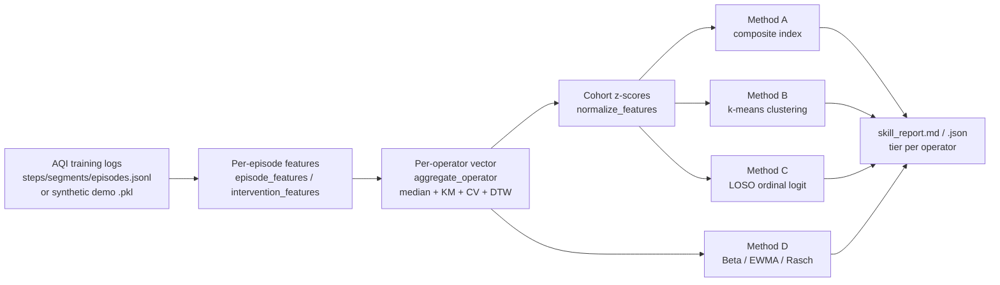

# Automatic Operator Skill Assessment

*How AQI-HIL-SERL types an operator — **human or synthetic** — as
`novice / intermediate / expert` (or a continuous score) purely from their
interaction logs.* This is **Part B** of the methodology ("Synthetic Operator
Models and **Automatic Skill Assessment** for HIL-SERL"); Part A (generating
graded operators) is documented in
[oracle_and_synthetic_operator.md](oracle_and_synthetic_operator.md) and
[synthetic_operators_and_skill.md](synthetic_operators_and_skill.md).

> **The idea in one line:** every demonstration and every intervention leaves a
> fingerprint — how smooth the motion is, how often the tool jams, how late a
> takeover fires. Aggregate those into a per-operator feature vector, normalize
> across the cohort, and four independent methods turn the vector into a skill
> label. The whole thing is validated on synthetic operators (whose true skill is
> known) before it is trusted on humans.

---

## Table of contents

1. [Why classify operators](#1-why-classify-operators)
2. [Where the code lives](#2-where-the-code-lives)
3. [The pipeline](#3-the-pipeline)
4. [The feature catalogue (Table 7)](#4-the-feature-catalogue-table-7)
5. [The four assignment methods](#5-the-four-assignment-methods)
6. [Censoring discipline](#6-censoring-discipline)
7. [Validation (does it actually work?)](#7-validation-does-it-actually-work)
8. [How to use it](#8-how-to-use-it)
   - [A. Assess operators from real training logs](#8a-assess-operators-from-real-training-logs)
   - [B. Campaign-level assessment](#8b-campaign-level-assessment)
   - [C. Validate the pipeline on synthetic operators](#8c-validate-the-pipeline-on-synthetic-operators)
   - [D. Programmatic API](#8d-programmatic-api)
   - [E. VS Code tasks](#8e-vs-code-tasks)
9. [Inputs and outputs](#9-inputs-and-outputs)
10. [Caveats and pitfalls](#10-caveats-and-pitfalls)
11. [Quick reference](#11-quick-reference)

---

## 1. Why classify operators

HIL-SERL trains a robot policy while a human takes over whenever they judge the
robot is about to fail. The trained policy therefore depends on **who**
supervised it. To study that dependency — and to check whether AQI reduces it —
we need to **type each operator's skill from evidence**, without a questionnaire
and without watching them. The same typing also lets a campaign label its roster,
sanity-check that a "novice" really behaved like one, and detect operator drift
over a long session.

Crucially, the method is **evidence-based and operator-agnostic**: it reads the
ordinary AQI training logs, so it types a real human exactly as it types a
synthetic operator. That symmetry is what lets us *validate on synthetics and
deploy on humans*.

---

## 2. Where the code lives

| piece | file | contents |
|---|---|---|
| skill pipeline | [`skill.py`](../serl_launcher/serl_launcher/aqi/skill.py) | features → aggregation → Methods A–D → validation → `features_from_aqi_logs` |
| supporting stats | [`stats.py`](../serl_launcher/serl_launcher/aqi/stats.py) | `wilson_interval`, `icc_oneway` (used by test-retest ICC) |
| standalone CLI | [`operator_skill.py`](../examples/operator_skill.py) | `--mode assess`, `--mode validate-synthetic` |
| campaign subcommand | [`experiment_pipeline.py`](../examples/experiment_pipeline.py) | `assess` → `report/skill.md` + `operators.csv` annotation |

Everything computes from the standard AQI log tuple; the intervention-quality
aggregates reuse the counterfactual-advantage numerator already logged per
segment, so no extra instrumentation is required.

---

## 3. The pipeline



1. **Per-episode features** — turn each trajectory into a row of interpretable
   numbers (smoothness, force, jams, alignment-at-commit, …).
2. **Per-operator aggregation** — collapse an operator's episodes into one vector,
   using **medians** and **censoring-aware** scalars (KM median, capped means),
   plus consistency features (CV of time, pairwise DTW, lapse frequency).
3. **Normalization** — per-task z-scores across the cohort so features are
   comparable; missing features z-score to 0 (no evidence either way).
4. **Assignment** — four independent methods (below) produce a tier and/or score.
5. **Validation** — on synthetic cohorts with known truth, measure accuracy,
   QWK, Spearman ρ and test-retest ICC.

---

## 4. The feature catalogue (Table 7)

Each feature carries a **direction sign** (`FEATURE_SIGNS` in
[`skill.py`](../serl_launcher/serl_launcher/aqi/skill.py)): `+1` = larger is
better, `−1` = smaller is better.

**Execution block** (`episode_features`):

| feature | meaning | better |
|---|---|---|
| `sr` | success rate | ↑ |
| `t_mean_capped`, `t_km_median` | time-to-success (capped mean + Kaplan-Meier median) | ↓ |
| `attempts`, `plr` | attempts; path-length ratio vs straight line | ↓ |
| `idle_frac` | fraction of steps barely moving | ↓ |
| `ldj`, `sparc` | log-dimensionless-jerk & spectral-arc-length smoothness | ↑ |
| `vel_peaks`, `reversals` | velocity peaks; vertical-direction reversals | ↓ |
| `f_peak`, `f_impulse`, `jams`, `scrape_frac` | force peak, force impulse, jam events, scraping fraction | ↓ |
| `commit_err` | alignment error at the moment of committing to insert | ↓ |
| `cv_t`, `dtw`, `lapse_freq` | consistency: CV of time, mean pairwise DTW, lapse frequency | ↓ |

**Intervention block** (`intervention_features`, Role-2 aggregates):

| feature | meaning | better |
|---|---|---|
| `intervention_rate`, `takeover_dur`, `over_assist` | how often / how long / how much beyond needed | ↓ |
| `onset_margin` | value-drop at takeover onset (did they catch it early?) | ↓ |
| `recovery`, `dv_rec` | success-given-takeover; recovered value | ↑ |
| `a_hat_mean`, `a_hat_frac_pos` | mean counterfactual advantage of their corrections; fraction that helped | ↑ |
| `unnecessary_frac` | fraction of takeovers that were unnecessary | ↓ |

The doc's worked example uses a **seven-feature core** (`CORE7`) that is robust on
small cohorts:

```python
CORE7 = ("sr", "t_mean_capped", "plr", "ldj", "jams", "idle_frac", "commit_err")
```

---

## 5. The four assignment methods

The methods are deliberately redundant — they agree when the signal is real and
disagree when it isn't.

### Method A — transparent composite index (`composite_score`, `composite_tiers`)

$$S_i = \frac{1}{|K|}\sum_{k\in K} \text{sign}_k \cdot z_{ik}$$

A signed average of the z-scored core features → one interpretable scalar per
operator. Default **tertile cuts** split the cohort into novice / intermediate /
expert (pass `--cuts`/anchor-derived cuts for skewed cohorts). Fully transparent
and needs no labels.

### Method B — unsupervised clustering (`cluster_operators`)

k-means (k = 3) on the z-vectors, with clusters **ordered by mean success rate**
before being read as novice/intermediate/expert. Reports **bootstrap label
stability** and raises a `small_cohort_warning` below 15 operators (labels are
unstable on tiny cohorts). No labels required.

### Method C — (ordinal) classification with LOSO CV (`loso_classify`)

A multinomial (or, if `statsmodels` is installed, **ordinal proportional-odds**)
logistic model, evaluated with **leave-one-OPERATOR-out** cross-validation (never
episode splits — that would leak). Reports **accuracy**, **macro-F1** and
**QWK** (quadratic-weighted κ, the correct ordinal loss: confusing novice with
expert costs 4× an adjacent slip). Requires ground-truth tier labels
(`--labels_json`).

### Method D — online estimators (`BetaBernoulliTracker`, `EWMAComposite`, `rasch_fit`)

For streaming / drift and difficulty adjustment:

- **`BetaBernoulliTracker`** — a Beta posterior on per-episode success with a
  90 % credible interval and tier bands (e.g. 7/10 → Beta(8,4), mean 0.667, CI
  [0.44, 0.86]).
- **`EWMAComposite`** — exponentially-weighted composite for a forgetting horizon
  (handles drift).
- **`rasch_fit`** — IRT/Rasch **difficulty-adjusted ability** `P(success) =
  σ(θ_op − b_task)`, so an operator on a hard task isn't penalized versus one on
  an easy task.

---

## 6. Censoring discipline

Time-to-success is **right-censored**: failed episodes have no completion time.
Reporting the mean of only successful times is selection-biased (the Table-5
lesson). The pipeline therefore:

- computes per-episode stats over **all** episodes with failures **capped at the
  budget** and flagged (`t_capped`, `censored`);
- reports the **Kaplan-Meier median** (`km_median`) as the honest time scalar;
- measures consistency with CV of capped time, pairwise DTW, and a **lapse
  frequency** (episodes beyond 2 MAD of the operator's own median time).

---

## 7. Validation (does it actually work?)

Before trusting the classifier on humans, run the **S11 closed loop** on synthetic
operators whose true skill is known (`operator_skill.py --mode validate-synthetic`).
It builds a jittered tier cohort, runs the full pipeline, and reports:

- **accuracy** and **macro-F1** (Methods A/B/C),
- **QWK** (ordinal agreement),
- **Spearman ρ** between the composite score `S` and true skill `s` over a
  9-point sweep,
- an **episodes-needed curve** (how many episodes to reach target accuracy),
- **test-retest ICC** (`test_retest_icc`, split-battery reliability via
  `icc_oneway`).

It prints `VALIDATION PASSED` when clustering ≥ 0.9, QWK ≥ 0.8, ρ ≥ 0.9 and
ICC ≥ 0.75. **Synthetic validation licenses ordinal claims only** — absolute human
thresholds must be re-anchored on human data.

---

## 8. How to use it

All commands assume the repo venv `./.venv/bin/python` and repo root as CWD.

### 8A. Assess operators from real training logs

Point the assessor at a directory whose **subdirectories are per-operator AQI-log
runs** (the run directory name, or its `meta.json` `operator_id`, is the operator
id):

```bash
./.venv/bin/python examples/operator_skill.py --mode assess \
    --log_root ./aqi_logs \
    --out_dir  ./skill_report
```

Add synthetic demo pkls and/or ground-truth labels:

```bash
./.venv/bin/python examples/operator_skill.py --mode assess \
    --log_root ./aqi_logs \
    --demo_glob 'synthetic_demos/*.pkl' \
    --labels_json truth.json \
    --out_dir ./skill_report
```

- `--demo_glob` — operator id = file stem; `*_groundtruth.json` sidecars supply
  success labels when present.
- `--labels_json` — `{operator: tier}` truth (`novice`/`intermediate`/`expert`)
  enables **Method C** (LOSO + QWK).
- `--cuts lo,hi` — composite cuts for skewed cohorts; `--budget_s`, `--pos_slice`
  match your env (default `0:3` positions in the logged `state`).

Method A (composite) + Method D (Beta-Bernoulli) always run; Method B (k-means)
runs when ≥ 8 operators; Method C runs when labels are given. Output:
`skill_report.md` + `skill_report.json`.

**To assess a human**, just run normal HIL-SERL with `--operator_id <name>` (any
instrumented mode: `logged`/`active`/`quality`/`aqi`) so the AQI runtime writes
`steps/segments/episodes.jsonl`, then point `--log_root` at those run dirs.

### 8B. Campaign-level assessment

Over a whole campaign's `aqi_logs`, grouped by operator:

```bash
./.venv/bin/python examples/experiment_pipeline.py assess --campaign runs/fasttest
```

Writes `report/skill.md` + `report/skill.json` and adds an **`assessed_tier`**
column to `operators.csv`.

### 8C. Validate the pipeline on synthetic operators

```bash
./.venv/bin/python examples/operator_skill.py --mode validate-synthetic \
    --out_dir ./val
# knobs: --val_ops_per_tier 10  --val_episodes 12  --val_seed 3
```

Prints accuracy / QWK / ρ / ICC and writes `validation.json`.

### 8D. Programmatic API

```python
from serl_launcher.aqi import skill as SK

# 1. real logs -> per-episode rows + intervention aggregates
r = SK.features_from_aqi_logs("aqi_logs/<run_dir>", budget_s=15.0)

# 2. one vector per operator (do this per operator id)
vec = SK.aggregate_operator(r["episode_rows"], budget_s=15.0,
                            interventions=r["interventions"])

# 3. cohort of operators -> normalize -> score/tier
vecs = {"op0": vec, "op1": ...}
Z = SK.normalize_features(vecs, SK.CORE7)
S = {o: SK.composite_score(Z[o]) for o in Z}       # Method A score
tiers = SK.composite_tiers(S)["tiers"]              # Method A tiers

# optional: Method B / C / D
clusters = SK.cluster_operators(Z, sr={o: vecs[o]["sr"] for o in vecs})
loso     = SK.loso_classify(Z, labels={"op0": 2, "op1": 0, ...})  # needs truth
bt       = SK.BetaBernoulliTracker(1 + vec["k_success"],
                                   1 + vec["n_episodes"] - vec["k_success"])
```

### 8E. VS Code tasks

- **operators: B) Assess operator skill from logs** → `operator_skill.py --mode assess`.
- **operators: C) Validate synthetic generator (calibration/S11)** → `--mode validate-synthetic`.

---

## 9. Inputs and outputs

**Input — AQI log run directory** (`features_from_aqi_logs`), produced by the
AQI runtime during actor training in any instrumented mode:

| file | key fields read |
|---|---|
| `steps.jsonl` | `episode`, `state` (positions via `pos_slice`), `f_norm`, `intervening`, optional `mu_q` |
| `segments.jsonl` | `episode`, `start_step`, `length`, `a_hat_mean`, optional `dv_on`/`dv_rec`, `unnecessary`, `episode_success` |
| `episodes.jsonl` | `episode`, `success` |
| `meta.json` | `operator_id` (+ ground-truth `θ` for synthetics) |

**Input — synthetic demo pkl** (`--demo_glob`): a repo-format transition list;
`<stem>_groundtruth.json` sidecar carries `θ` and outcomes.

**Output:**

- `skill_report.md` / `skill_report.json` — per-operator features, z-scores,
  composite `S`, tiers from each method, Beta posterior + CI.
- campaign `report/skill.md` / `skill.json` and the `assessed_tier` column in
  `operators.csv`.
- `validation.json` — the S11 metrics.

---

## 10. Caveats and pitfalls

- **LOSO only, never episode splits** — grouping the same operator's episodes
  across train/test leaks identity and inflates accuracy.
- **Small cohorts** — clustering (Method B) warns below 15 operators; prefer the
  composite (A) and Beta (D) there.
- **Censoring** — always use capped means + KM medians; raw successful-time means
  are selection-biased.
- **Matched-phase intervention comparisons** — Role-2 features must be compared at
  the same training phase; the counterfactual-advantage aggregates depend on
  critic warm-up.
- **Synthetic validation licenses ordinal claims; human thresholds re-anchor** —
  the report footer says so; treat absolute cut values as cohort-relative.
- **Goodhart** — keep assessed operators blind to the scoring details, or they can
  game the features.

---

## 11. Quick reference

- **What:** type any operator (human or synthetic) as novice/intermediate/expert
  (or a continuous `S`) from AQI logs — methodology Part B.
- **Core files:** [`skill.py`](../serl_launcher/serl_launcher/aqi/skill.py),
  [`operator_skill.py`](../examples/operator_skill.py),
  [`experiment_pipeline.py`](../examples/experiment_pipeline.py) `assess`.
- **Pipeline:** features → per-operator vector (median + KM + CV + DTW) →
  cohort z-scores → Methods A/B/C/D → report.
- **Methods:** A composite (no labels), B clustering (≥15 ops), C LOSO ordinal
  logit + QWK (needs labels), D Beta/EWMA/Rasch (online, difficulty-adjusted).
- **Assess:** `operator_skill.py --mode assess --log_root <runs> --out_dir <out>`.
- **Validate:** `operator_skill.py --mode validate-synthetic`.
- **Campaign:** `experiment_pipeline.py assess --campaign <dir>`.
- **Golden rules:** censoring-aware scalars; LOSO not episode splits; validate on
  synthetics before trusting on humans.

---

## Script CLI reference — `operator_skill.py`

Two modes selected with `--mode`:

### `assess` — type real or synthetic operators from logs or demo files

```bash
cd examples

# from training logs (one run dir per operator, named by operator id)
python operator_skill.py --mode assess \
    --log_root aqi_logs \
    --out_dir skill_out/

# from a campaign's aqi_logs
python operator_skill.py --mode assess \
    --log_root ~/campaigns/study1/aqi_logs \
    --out_dir ~/campaigns/study1/report/skill

# from synthetic demo pkl files (uses _groundtruth.json sidecars for labels)
python operator_skill.py --mode assess \
    --demo_glob "demo_data/cylinder/synthetic/*_demos.pkl" \
    --out_dir skill_out/
```

| Flag | Description |
|---|---|
| `--log_root <dir>` | directory of per-operator `aqi_logs/` run dirs |
| `--demo_glob <pattern>` | glob of demo `.pkl` files (operator id = file stem) |
| `--out_dir <dir>` | output directory |
| `--labels_json <file>` | ground-truth tier labels (enables Method C / QWK) |

**Outputs:**

| File | What it contains |
|---|---|
| `skill_report.md` | per-operator feature table, composite score, tier assignment |
| `skill.json` | machine-readable version |

### `validate-synthetic` — closed-loop validation on the toy study

Jitters a synthetic cohort, runs the full pipeline, checks accuracy/QWK/ICC.
This is the gate that must pass before the pipeline is trusted on humans.

```bash
python operator_skill.py --mode validate-synthetic --out_dir val_out/
```

### Connections

```
train_aqi_rlpd.py  ──writes──▶  aqi_logs/<run>/  (episodes + segments + steps)
collect_synthetic_demos.py  ──writes──▶  demos.pkl + _groundtruth.json

operator_skill.py  ◀──reads──  aqi_logs/  OR  demo pkls
                  ──writes──▶  skill_report.md, skill.json

experiment_pipeline.py assess  (uses serl_launcher.aqi.skill directly,
                                same logic as operator_skill.py)
run_campaign.py    assess stage (same library, not operator_skill.py CLI)
```
