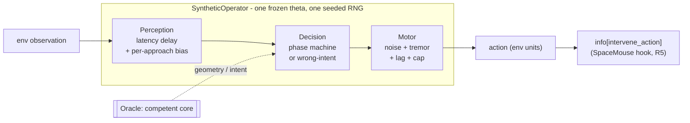
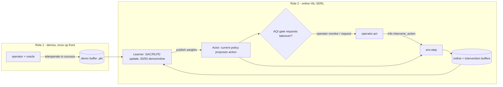

# The Oracle and the Synthetic Operator

A deep-dive into how AQI-HIL-SERL replaces a human teleoperator with a graded,
reproducible **synthetic operator**, and the **oracle** that gives it its
competence. This is the "why and how" behind
[`serl_launcher/serl_launcher/aqi/operator_model.py`](../serl_launcher/serl_launcher/aqi/operator_model.py)
and its companions.

> **One-line mental model:** an **oracle** knows how to do the task perfectly;
> the **synthetic operator** wraps that oracle and *degrades* it into a
> human-plausible teleoperator with a known skill level. Noise never touches the
> environment's observation — it enters the operator's *perception* and its
> *motor command*.

---

## Table of contents

1. [Architecture at a glance](#1-architecture-at-a-glance)
2. [The oracle layer — the competent core](#2-the-oracle-layer--the-competent-core)
   - [Option A: the geometric `PhaseOracle`](#21-option-a-the-geometric-phaseoracle)
   - [Option B: the `PolicyOracle`](#22-option-b-the-policyoracle)
   - [How the oracle is chosen](#23-how-the-oracle-is-chosen)
3. [The synthetic operator — perception → decision → motor](#3-the-synthetic-operator--perception--decision--motor)
   - [`θ`: the skill parameter vector](#31-θ-the-skill-parameter-vector)
   - [Perception](#32-perception)
   - [Decision](#33-decision)
   - [Motor](#34-motor)
4. [Exactly what the noise is injected into](#4-exactly-what-the-noise-is-injected-into)
5. [Motor noise in detail](#5-motor-noise-in-detail)
6. [The two roles: demos and interventions](#6-the-two-roles-demos-and-interventions)
7. [Geometric oracle vs policy oracle: demo path vs training path](#7-geometric-oracle-vs-policy-oracle-demo-path-vs-training-path)
8. [Training a policy using *only* synthetic operators](#8-training-a-policy-using-only-synthetic-operators)
9. [File map](#9-file-map)
10. [Quick reference](#10-quick-reference)

---

## 1. Architecture at a glance

The synthetic operator plugs in at exactly the point a SpaceMouse would
(`info["intervene_action"]`), so nothing downstream can tell it from a human
(design requirement **R5**). It is a three-stage pipeline sitting on top of an
oracle:



- The **oracle** answers *"what is the correct thing to do here?"* — either from
  known geometry (option A) or from a trained policy (option B).
- The **operator** answers *"what would a human of skill `s` actually do?"* — by
  perceiving late and biased, sometimes deciding wrong, and always executing with
  shaky hands.

All skill degradation lives in the operator. **The oracle is always clean and
competent**; it never adds error.

---

## 2. The oracle layer — the competent core

The oracle is defined by two small interfaces in
[`operator_model.py`](../serl_launcher/serl_launcher/aqi/operator_model.py)
(doc S4). Both expose whatever the operator's decision block needs to produce a
*competent intent*.

### 2.1 Option A: the geometric `PhaseOracle`

`PhaseOracle` exposes **task-geometry primitives** that a generic
`approach → align → descend` phase machine consumes. It must be implemented per
environment:

| method | meaning |
|---|---|
| `lateral_error(obs)` | true lateral offset of the tool from the insertion axis (mm) |
| `height(obs)` | tool height above the surface (mm) |
| `in_contact(obs)` | is the tool touching / inside? |
| `jammed(obs)` | contact **without** progress (drives recovery) |
| `commit_threshold()` | perceived `|error|` below which the operator commits to descend (≈ 0.8 × clearance) |
| `approach_height()` | boundary between "approach fast" and "align slowly" |
| `lateral_dims`, `vertical_dim`, `action_dim()` | which action components mean what |

Two implementations ship:

**Toy oracle — `ToyInsertionOracle`**
([`toy_insertion.py`](../serl_launcher/serl_launcher/aqi/toy_insertion.py))
for the 2-D worked example (`ToyInsertionEnv`: peg `(x, z)`, hole at `x=0`,
1 mm clearance, 20 mm deep, 10 Hz). It reads the **observation vector**
`state = [x, z, vx, vz, F_lat, F_z, jam_frac, t_frac]`:

```python
lateral_dims = (0,); vertical_dim = 1          # action = (vx, vz)
lateral_error(obs) = [state[0]]                # hole at x=0, so error == x
height(obs)        = state[1]                  # == z
in_contact(obs)    = F_z > 0.05 or z < 0
jammed(obs)        = F_z > 0.05                # pressing off-axis at the surface
commit_threshold() = 0.8 * 1.0 mm; approach_height() = 8.0 mm; action_dim() = 2
```

> **Important:** the toy oracle reads the **delayed, operator-side observation**,
> so the operator's `latency` *does* apply to its geometric perception.

> **The "physics of failure" (why the oracle's signals mean something).**
> `ToyInsertionEnv` is a peg tip `(x, z)` under velocity control at 10 Hz: hole at
> `x = 0` in the surface `z = 0`, **1 mm** radial clearance, **20 mm** deep, a
> **jam budget of 25** contact events, a **15 s** budget, start `x₀ ~ U(−30, 30) mm`
> at `z₀ = 60 mm`. Pressing **down while off-axis** at the surface *jams*: friction
> impedes lateral correction and a wedge term drifts the tip further out — so
> **shoving makes it worse**. Exceeding 25 jam events = *damaged* (failure);
> descending inside to `z ≤ −20 mm` = *success*. This is exactly why the operator's
> `q_rec` (retract-and-realign vs shove) **separates the tiers** on the toy env.
> One simplification: `jammed` and the first clause of `in_contact` use the same
> test (`F_z > 0.05`) — the env only raises `F_z` in the at-surface, misaligned,
> pressing branch, so here "contact" and "jam" are not independently sensed (a
> clean proxy, fine for the toy study; a real cell would separate a healthy
> in-hole contact from a jam).

**Sim oracle — `SimPegPhaseOracle`**
([`wrapper.py`](../examples/experiments/sim_peg_insertion/wrapper.py))
for the MuJoCo peg task. It reads **live ground-truth sensors** (`peg_tip_pos`,
`hole_top_pos`, `hole_bottom_pos`, pinch quaternion), returns lateral error in the
**end-effector frame** (so `RelativeFrame` rotates the correction back onto the
bore), and height in world mm:

```python
lateral_dims = (0, 1); vertical_dim = 2        # EE x, y, z  (action_dim == 6)
lateral_error: e_ee = R_ee.inv() @ (tip - hole_bottom);  return e_ee[:2] * 1000  # mm
height:        (tip_z - hole_top_z) * 1000     # mm above the opening
jammed:        height <= contact_h and |lateral_error| > clearance
commit_threshold() = 0.8 * clearance           # cylinder 8 mm, cuboid 5, hex 3
```

Because it reads live sensors, the operator's `latency` does **not** apply to the
sim geometric channel (a deliberate v1 simplification). The vertical action sign
is fixed once per episode by `_VerticalSignAdapter`, and one action unit ≈ 0.01 m
per step = 100 mm/s.

| | toy `ToyInsertionOracle` | sim `SimPegPhaseOracle` |
|---|---|---|
| source | delayed observation | live sensors |
| latency on geometry | **yes** | no |
| lateral dims | 1 (`x`) | 2 (EE `x, y`) |
| action dim | 2 | 6 |
| clearance | 1 mm | 8 / 5 / 3 mm (cyl / cuboid / hex) |
| frame handling | none | `RelativeFrame` + `_VerticalSignAdapter` |

### 2.2 Option B: the `PolicyOracle`

When an environment has **no usable geometry** (e.g. a real cell with no known
hole pose), the competent core is instead a **trained policy checkpoint**
`π_or`. `PolicyOracle` is a thin wrapper:

```python
class PolicyOracle:
    def intent(self, obs):
        return np.asarray(self.policy_fn(obs)) * self.action_scale   # env action -> mm/s
```

In [`train_aqi_rlpd.py`](../examples/train_aqi_rlpd.py) `policy_fn` is a
**frozen, deterministic** copy of the agent restored from `--oracle_checkpoint`:

```python
ckpt = checkpoints.restore_checkpoint(os.path.abspath(FLAGS.oracle_checkpoint), agent.state)
oracle_agent = agent.replace(state=ckpt)                      # separate frozen copy
def policy_fn(obs):
    return np.asarray(jax.device_get(
        oracle_agent.sample_actions(observations=..., argmax=True, seed=okey)))  # deterministic
oracle = PolicyOracle(policy_fn, action_dim=env.action_space.shape[0], action_scale=mm_per_unit)
```

Key properties:

- **It is not trained here.** It is a pre-existing checkpoint you supply (a
  converged HIL-SERL policy, a BC policy from demos, or any earlier checkpoint of
  the same architecture). It receives **no gradients** — the learner trains the
  *main* agent, not `oracle_agent`.
- It runs with `argmax=True` (no exploration noise) and a fixed seed.
- Because there's no phase machine, the operator degrades it differently — see
  [§3.3](#33-decision) wrong-intent segments.
- Chicken-and-egg: option B needs a competent policy *before* it can supply one,
  which is why **sim prefers the geometric oracle**.

### 2.3 How the oracle is chosen

`_wrap_synthetic_operator` in [`train_aqi_rlpd.py`](../examples/train_aqi_rlpd.py)
resolves the execution oracle in priority order:

1. `env.synthetic_oracle` — the full geometric operator the **sim** attaches
   (execution *skill* shapes the correction; uses the env's action scale + sign
   fix);
2. `env.phase_oracle` — a phase oracle exposed directly (e.g. the **toy** env);
3. `--oracle_checkpoint` — a frozen policy as `π_or` (**option B**), correct
   action frame but skill-independent competence.

On sim the checkpoint is only used if you explicitly pass one; `auto`/`none`
means "use the geometric oracle."

---

## 3. The synthetic operator — perception → decision → motor

`SyntheticOperator` (
[`operator_model.py`](../serl_launcher/serl_launcher/aqi/operator_model.py))
= **one frozen `θ` + one seeded RNG** (determinism, **R6**). Every control step,
`act(obs)` runs three blocks.

### 3.1 `θ`: the skill parameter vector

`OperatorTheta` holds every knob on **two independent skill axes** (doc S1.2):

**Execution (motor / perception)**

| param | meaning | units |
|---|---|---|
| `sigma0` | baseline motor noise | mm/s |
| `k_sdn` | signal-dependent noise gain (noise grows with speed) | — |
| `sigma_tr` | OU tremor intensity (band-limited wobble) | mm/s |
| `latency` | perception→action delay | steps @10 Hz |
| `lag` | first-order motor lag (command smoothing) | — |
| `v_max` | speed cap | mm/s |
| `sigma_perc` | per-**approach** perceptual bias std | mm |
| `p_pause`, `pause_len_mean` | hesitation frequency / duration | /step, s |
| `q_rec` | retract-and-realign prob on a jam (vs shove) | /jam-step |
| `p_early` | premature-commit prob | /attempt |
| `p_lapse` | whole-episode lapse prob (inflates all noise ×2.5) | /episode |

**Monitoring (supervisory)**

| param | meaning |
|---|---|
| `sigma_mon` | noise on the risk estimate `z ∈ [0,1]` |
| `delta_in`, `m_in` | takeover threshold / consecutive steps above it |
| `l_react` | reaction delay after detection (steps) |
| `p_miss` | probability of missing a true failure event |
| `rho_fa` | false alarms per minute |
| `delta_out`, `k_out` | hand-back threshold / consecutive steps below it |
| `d_max` | max takeover duration (s) |

Plus ground truth: `s_exec`, `s_mon`, `tier`, `operator_id` (**R2**).

**Tier anchors** (`expert = s 1.0`, `intermediate = 0.5`, `novice = 0.0`),
representative slice:

| | expert | intermediate | novice |
|---|---|---|---|
| `sigma0` (mm/s) | 1.5 | 5.0 | 10.0 |
| `k_sdn` | 0.02 | 0.05 | 0.10 |
| `v_max` (mm/s) | 90 | 70 | 55 |
| `latency` (steps) | 1 | 2 | 4 |
| `sigma_perc` (mm) | 0.30 | 1.0 | 2.2 |
| `q_rec` | 0.60 | 0.30 | 0.08 |
| `p_lapse` | 0.03 | 0.06 | 0.15 |
| `delta_in` | 0.45 | 0.60 | 0.80 |
| `l_react` (steps) | 3 | 5 | 8 |
| `p_miss` | 0.05 | 0.15 | 0.35 |
| `rho_fa` (/min) | 0.2 | 0.5 | 1.2 |

- `theta_from_scale(s_exec, s_mon)` interpolates between anchors — **geometric**
  for scale-like params (equal steps in `s` = equal ratios), **linear** for
  probabilities/criteria, integers rounded. Ask for any `s = 0.7`, or a mixed
  `exec=expert, mon=novice`.
- `jitter_theta(θ, rng, strength=0.15)` multiplies each scale-like param by
  `exp(𝒩(0, strength²))`, turning each tier into an **overlapping cloud** of
  distinct operators (so between-operator variance exists to measure).

> **Is a "tier" a population or a single operator?** It depends on the entry
> point. A tier is a **point** in θ-space (the anchor), so by itself it is one
> deterministic θ — but a `SyntheticOperator` with a *fixed* θ is still
> **stochastic every episode** (per-approach perceptual bias, per-step motor
> noise, OU tremor, hesitation pauses, whole-episode lapses). That is what makes
> **R1** hold *statistically*: expert and novice separate *in distribution*, not
> deterministically — a novice succeeds sometimes, just 3–7× slower. You get a
> **population** of distinct operators only when you turn on jitter:
> `operator_skill.py --mode validate-synthetic` builds jittered cohorts per tier
> (to test the classifier against overlapping tiers), whereas demo collection and
> the actor use **one fixed-θ** operator by default (jitter off) — still
> per-episode stochastic. The competent **oracle** is always fixed; the tier is a
> fixed θ-anchor; a sampled operator *population* is opt-in via jitter.

### 3.2 Perception

`_perceive(obs)` keeps a `latency`-length deque and returns the observation from
`latency` steps ago. The alignment estimate then carries a **per-approach bias**:

$$\hat{e} = e_{\text{true}} + \eta, \qquad \eta \sim \mathcal{N}(0,\ \sigma_{\text{perc}}^2)$$

The bias `η` is resampled **only when the operator re-examines the scene** (after
a retract) — never per step. Per-step resampling would average the mis-estimate
away and erase tier separation (the documented pitfall, **R3**).

### 3.3 Decision

**With a `PhaseOracle` (`_intent_phase`)** — a phase machine emits an intent
velocity `u` by proportional control on the *perceived* error:

```python
u[d] = np.clip(-k * err_hat[i], -v_max, v_max)   # lateral correction
```

- `approach`: descend fast until near `approach_height`, then switch to `align`;
- `align`: creep down slowly; commit to `descend` when the smoothed perceived
  `|error|` < `commit_threshold` — or **prematurely** with prob `p_early`;
- on a **jam**: retract with prob `q_rec` (expert style) else **shove through**
  (novice style: `u[vertical] = -0.6·v_max`, the failure mode that accrues jam
  events).

**With a `PolicyOracle` (`_intent_policy`)** — the competent intent is
`u = oracle.intent(obs)`, degraded by **temporally-correlated wrong-intent
segments** of 0.5–1.5 s, entered at a rate governed by `p_miss` (tripled near
contact):

- `freeze` — hold the last action;
- `scale` — collapse to 20 % magnitude;
- `rotate` — twist the first two dims by 0.8 rad.

### 3.4 Motor

`_motor(u)` turns the intended command into what the "hand" actually does:

$$
\varepsilon_t \sim \mathcal{N}\!\big(0,\ \sigma_\varepsilon^2\big),\quad
\sigma_\varepsilon = (\sigma_0 + k_{\text{sdn}}\lVert u_t\rVert)\, m_{\text{lapse}},\qquad
a_t = (1-\gamma)\,a_{t-1} + \gamma\,(u_t + \varepsilon_t + \text{OU}_t),\quad
\lVert a_t\rVert \le v_{\max}
$$

with geometric hesitation **pauses** (`p_pause`, mean `pause_len_mean`) that zero
the command, and whole-episode **lapses** (`p_lapse`) that set
`m_lapse = 2.5`. The result is returned in env units (`× action_scale`). See
[§5](#5-motor-noise-in-detail).

---

## 4. Exactly what the noise is injected into

Noise is **not** added to the environment's observation/state vector — that is
only *delayed* by `latency`. It enters in **two** places:

**(a) Perception → the lateral-error estimate.**

```python
err_hat = err_true + self.bias    # bias ~ N(0, sigma_perc^2), per approach
```

`err_true = oracle.lateral_error(obs)` (mm; 1-D toy, 2-D sim EE x/y). The decision
block computes the command from `err_hat`, so a biased percept steers the whole
approach slightly wrong.

**(b) Motor → the intent velocity command `u`.**

`u` is the operator's desired per-actuator velocity in mm/s, shape
`oracle.action_dim()`. Signal-dependent Gaussian `eps` and OU tremor are added
**elementwise to every component of `u`**, then lag-filtered and speed-capped:

| oracle | `action_dim` | `u` components (mm/s) | phase machine writes |
|---|---|---|---|
| `ToyInsertionOracle` | 2 | `[v_x, v_z]` | both |
| `SimPegPhaseOracle` | 6 | `[vx, vy, vz, roll, pitch, yaw]` | dims 0,1,2 (3–5 stay 0 → get **pure noise**, hence translation-only / cylinder) |
| `PolicyOracle` | env dim | policy action × `action_scale` | whole vector (degraded by wrong-intent) |

**In one sentence:** noise corrupts the operator's *lateral-error percept* and its
*intent velocity command* — never the environment observation, which is only
time-delayed.

---

## 5. Motor noise in detail

"Motor noise" is the **execution-channel** corruption in `_motor()`: even when the
operator intends exactly `u`, its hand produces a jittered, lagged version. It is
the "unsteady hands" channel, distinct from perceiving the wrong target
(perception) or planning the wrong move (decision).

- **Core term — signal-dependent Gaussian.** `sd = (sigma0 + k_sdn·‖u‖)·m_lapse`;
  `eps ~ N(0, sd²)` per component. The defining feature is **signal-dependence**:
  scatter grows with how hard/fast you command (`‖u‖`), the standard motor-control
  model of biological noise. `sigma0` is the floor; `k_sdn` the growth rate.
- **Shaping so it doesn't look like white noise:**
  - **first-order lag** `γ` low-pass-filters command+noise → temporally
    correlated jitter;
  - **OU tremor** (`sigma_tr`) adds a separate band-limited wobble;
  - **lapse** inflation (`m_lapse = 2.5`) on a whole lapse episode;
  - **`v_max`** clamps the magnitude.
- **Tier scaling:** expert `sigma0=1.5, k_sdn=0.02` → novice `10.0, 0.10` (≈ 6.7×
  more baseline scatter, 5× steeper signal-dependence).

What it is **not**: perception bias, decision error, or RL exploration noise. It
lives entirely inside the operator, upstream of `info["intervene_action"]`.

---

## 6. The two roles: demos and interventions

The **same `θ`** drives both roles (**R4**):

- **Role 1 — demonstrations.** The operator teleoperates full episodes from reset
  to termination; successful (or all) episodes are recorded in training format.
  See [`collect_synthetic_demos.py`](../examples/collect_synthetic_demos.py) (toy)
  and the sim `collect-synth` path (`make_synthetic_sim_env`).
- **Role 2 — interventions.** During RL, a **monitoring gate**
  ([`operator_gate.py`](../serl_launcher/serl_launcher/aqi/operator_gate.py))
  watches a risk signal `z_t` and decides *when* to take over using
  signal-detection-theory parameters:

  ```text
  zhat = EWMA(z) + N(0, sigma_mon)
  trigger  when zhat > delta_in for m_in consecutive steps, then react after l_react
  miss     whole events with probability p_miss;  false alarms at Poisson rate rho_fa
  hand back when zhat < delta_out for k_out steps, or after d_max seconds
  ```

  When it fires, the *same* execution model produces the correction (competent
  core → degradation → motor noise). In active/aqi modes the operator instead
  **responds to the robot's own request** (`respond_to_request=True`), skill-
  modulated by the same reaction/miss/false-alarm machinery.

Because both roles share one `θ`, a jumpy novice both *teaches* wobbly successes
and *intervenes* late and imperfectly — consistently.

### 6.1 The risk signal `z_t` and the take-over gate, in detail

Role 2 is modeled as **signal detection**: the operator watches a risk signal,
decides to grab control, does the correction, then decides to let go — two objects
in [`operator_gate.py`](../serl_launcher/serl_launcher/aqi/operator_gate.py).

**The true risk `z_t ∈ [0,1]` (`MonitoringSignal`)** is the **max** of a few
normalized channels (trouble on *any one* = trouble):

| channel | definition |
|---|---|
| timeout pressure | `min(1, t/budget) · 0.5` — pressure, not panic (weight 0.5) |
| corridor (lateral) | `‖e_lat‖ / clearance`, **only** once the tip is near the surface (off-axis high up is normal; an optional wider *hover* corridor allows some drift above `approach_height`) |
| stagnation | no downward progress for `stall_s` while not yet inserted |
| contact / force | normalized force magnitude when available |

If the peg is below the opening and clearly off-axis it returns `1.0` immediately
(urgent). The operator does **not** see `z_t` directly — it sees a noisy, smoothed
version.

**The gate (`SyntheticInterventionGate`)** converts `z_t` into an observed risk
`ẑ_t` and runs a hysteresis state machine:

$$
\hat z_t=(1-\lambda)\,\hat z_{t-1}+\lambda\,z_t+\varepsilon_t,
\qquad \varepsilon_t\sim\mathcal N(0,\sigma_{\text{mon}}^2),\quad \lambda=0.4 .
$$

- **Take over** when `ẑ > delta_in` for `m_in` consecutive steps (debounce), then
  after a reaction delay `l_react` — unless the operator **misses** the whole
  event with probability `p_miss`.
- **False alarms** fire spontaneously at Poisson rate `rho_fa` per minute
  (`P ≈ rho_fa · dt / 60` per step).
- **Hand back** when `ẑ < delta_out` for `k_out` steps, or after `d_max` seconds
  (forced release).

The **hysteresis** (`delta_in` > `delta_out`) prevents on/off flicker. On trigger,
`begin_takeover()` resamples the perceptual bias (a fresh look) and runs the
recovery macro *stabilize → retract → re-align → re-attempt* through the
operator's own motor model; whether it retracts cleanly or stubbornly shoves comes
from `q_rec`. The executed action is published as `info["intervene_action"]`
(byte-identical to the SpaceMouse path), and each step logs `z`, `z_task`,
`request`, `zhat`, `taking_over`, `false_alarm`, plus the intervention mode and
latch state.

**Monitoring anchors** — the supervisory styles come straight from `MON_ANCHORS`:

| param | expert | intermediate | novice | meaning |
|---|---|---|---|---|
| `delta_in` | 0.45 | 0.60 | 0.80 | how bad before I grab (lower = earlier) |
| `sigma_mon` | 0.05 | 0.12 | 0.22 | how noisily I perceive risk |
| `l_react` | 3 | 5 | 8 | reaction delay (steps) |
| `p_miss` | 0.05 | 0.15 | 0.35 | chance I miss a real event |
| `rho_fa` (/min) | 0.2 | 0.5 | 1.2 | false alarms per minute |
| `delta_out` / `k_out` | 0.15 / 3 | 0.25 / 5 | 0.35 / 8 | calm threshold + steps before I let go |
| `d_max` (s) | 3 | 5 | 8 | max hold before forced release |

So the **expert supervisor** notices trouble early and accurately, reacts fast,
rarely misses, rarely false-alarms, and hands back promptly; the **novice**
reacts only once things are already bad, perceives noisily, reacts late, misses a
third of events, false-alarms often, and over-holds control.

### 6.2 Two sources of the gated signal: `z_task` vs `request`

The signal `z` fed to the gate is **context-dependent**:

- **baseline / quality / logged:** `z = z_task` — the operator's own geometric
  monitor decides when to help;
- **active / aqi:** `z = request` — the operator **responds to the robot's own
  active-learning request** (a binary 0/1), skill-modulated by the *same*
  reaction / miss / false-alarm machinery (`z_task` is still computed, for
  logging).

This is why in active/aqi modes every tier *responds to the query* rather than
using its private monitor — and why a novice supervisor still misses ~35 % of
requests and reacts late. (It also avoids a pause-mode deadlock: if the policy
pauses on a request and the operator ignored it, the episode would stall.)

### 6.3 Intervention modes and their interaction with convergence

`SyntheticOperatorWrapper` supports three latch behaviors
(`--synthetic_intervention_mode`):

| mode | behavior |
|---|---|
| `signal` | normal gate hysteresis (take over / hand back on the signal) |
| `always_latch` | once takeover begins, hold control until a success |
| `latch_until_autonomous_success` | keep strong assistance until the *first* fully autonomous success, then switch permanently to `signal` |

> **Practical caveat for the study.** `latch_until_autonomous_success` combined
> with an **autonomous** convergence rule (an episode counts only if the operator
> never took over — see [methods.md §3.6](methods.md)) can keep a cell
> *non-converged* even while it is succeeding: as long as interventions keep
> firing, no episode counts toward the autonomous window. A jumpy/novice operator
> (high `rho_fa`, low `delta_in`) makes this worse. To let policies prove autonomy
> sooner, use `signal` mode or relax the rule (`converge_allow_assisted`, lower
> `converge_success`, smaller `converge_window`) — or reduce operator jitter.

---

### 6.4 Rotation control (`--synthetic_rotation_control`)

**Why.** The geometric operator's intent sets only the x, y, z dims; the
rotation dims stay at zero, but its motor noise and tremor reach them. A twist
of the tool — from the untrained policy's random rotations or from the
operator's own tremor — is therefore never undone. On the cuboid (5 mm
clearance, ±0.08 rad random yaw at reset) this showed in the W&B episodes of
the training-machine campaigns: in the first 10 k steps 90–99 % of episodes
ran into the 300-step limit and even episodes in which the operator controlled
75–90 % of the steps succeeded only 7 % of the time.

**What it does** (`SyntheticOperator(..., rotation_control=True)`, oracle
method `orientation_error`):

| piece | behaviour |
|---|---|
| command | in every phase, `u_rot = ROT_GAIN · err / rad_per_unit` (30 % of the error per step), capped at `v_max` per axis; `err` is the rotation vector from the current tool orientation to the nearest insertable one, in the end-effector frame |
| target | the aligned home orientation of the reset (`_reset_quat`, before the random yaw), turned by any multiple of the bore symmetry: 90° cuboid, 60° hex; for the round cylinder only the tilt counts |
| commit | descend only once the perceived lateral error is inside the threshold **and** `|err| < ROT_TOL` (0.03 rad) |
| jam | a tool twisted by more than `ROT_JAM` (0.08 rad) while in contact counts as jammed: retract with `q_rec`, else push through while turning |
| motor | translation and rotation get separate signal-dependent noise and separate `v_max` caps |

The operator's tier still shows in the rotation channel through its motor noise,
lag and pauses; there is no separate orientation-perception bias.

**Off by default.** With the switch off the operator is byte-identical to the
earlier one (checked step by step against the previous code), and every
earlier config produces the same commands. The switch is campaign-wide
(`aqi.synthetic_rotation_control`), like the intervention mode, because the
operator must be the same for every arm; the HiRIL pipeline refuses it.

**Check without training.** `examples/oracle_insertion_test.py` lets the
operator insert alone (solo) and after random actions (rescue, a latched
takeover), per shape, tier and setting; on CLAIX `cluster/claix/oracle_test.sbatch`
runs it on the free CPU partition. The training pilot is
`examples/campaigns/rotfix_pilot_{base,rot,rotlatch}.yaml`.

### 6.5 Takeover-channel logging (`--log_takeover_channels`)

**Why.** `z_t` is the maximum over several channels (§6.1), so a takeover
count alone does not say *why* the operator stepped in: the time pressure, a
lateral error near the hole, a stall, a missed bore, force, or a false alarm.
Nor does it say how a takeover ended: the gate handing back early on the
signal, the `d_max` cap, a latched success, or the episode limit.

**What it logs** (logging only; the operator acts exactly as without it, checked
step by step against the previous code):

| where | key | values |
|---|---|---|
| `info["synthetic_operator"]`, on the step a takeover starts | `takeover_channel` | `time`, `corridor`, `stagnation`, `hover`, `off_bore`, `force`, `force_excess`, `value`, `sigma`, `false_alarm`, `request` |
| `info["synthetic_operator"]`, on the step a takeover ends | `handback_kind` | `signal` (hysteresis), `time_cap` (`d_max`), `latch_success`, `episode_end` (still in control when the episode ended) |
| `<checkpoint>/episodes.jsonl`, per episode | `takeover_channels`, `handbacks` | counts per channel and per kind |

The channel of a takeover is the one that set `z_t` most often over the
detection and reaction window before it (`m_in + l_react + 1` steps); a
spontaneous trigger is `false_alarm`; in active modes, where the operator
answers the robot's request, it is `request`. `MonitoringSignal.last_channel`
names the largest channel of the latest `z_t`. Campaign-wide YAML key:
`logging.takeover_channels`.

---

## 7. Geometric oracle vs policy oracle: demo path vs training path

The same operator model uses a **different competent core** on each path:

| | demo-collection path | training / actor path |
|---|---|---|
| entry point | `make_synthetic_sim_env` / `collect_synthetic_demos.py` | `--synthetic_operator … [--oracle_checkpoint]` |
| execution oracle (sim) | **geometric** `SimPegPhaseOracle` (option A) | geometric if attached; else **PolicyOracle** (option B) |
| why | no policy exists yet — demos are what you train *from*; geometry needs only the known hole pose | a policy checkpoint now exists and is a realistic competent core to degrade |
| monitoring (sim) | n/a (full teleop) | geometric `env.synthetic_monitor` (corridor / stagnation / force) |

So *"on the training path the oracle is instead a trained policy checkpoint
(option B); the geometric oracle is what makes demo collection on sim possible"*
means: geometry can drive a whole successful episode from scratch (needed up
front, when no policy exists), whereas during training you can degrade an actual
learned policy. On sim, the **geometric oracle is still the default even for
training execution**; the policy oracle is the fallback for geometry-free settings.

### 7.1 Bootstrapping a policy oracle from a geometric baseline

The `PolicyOracle` chicken-and-egg (§2.2 — you need a competent policy before you
can degrade one) has a clean resolution on sim: **train one baseline with the
geometric oracle, then reuse its checkpoint as the policy oracle** for every tier
and — crucially — for **shapes the geometric operator cannot do**:

1. **Collect demos** once (e.g. 25 expert synthetic demos, or SpaceMouse).
2. **Train a baseline to convergence** with the geometric oracle
   (`hilserl`, cylinder) → `run_cylinder_hilserl/checkpoint_XXXX/`.
3. **Verify quality** on the ruler — it should reach ≥ 0.8 autonomous SR.
4. **Reuse it as the oracle** for all tiers and shapes: pass
   `--oracle_checkpoint = run_cylinder_hilserl/checkpoint_XXXX`, and select
   `--synthetic_operator = expert|intermediate|novice` and
   `--peg_shape = cylinder|hex|cuboid`.

Why this unlocks hex/cuboid: the geometric operator is **translation-only** (no
yaw), so it reliably drives the **cylinder** only. A trained checkpoint already
knows yaw, contact dynamics and all action frames, so degrading *it* per tier
(motor noise, tremor, wrong-intent segments, premature commits) yields realistic
operator-like behavior at every skill level on shapes that need yaw. Set
`SIM_ORACLE_CHECKPOINT` **explicitly** to the converged baseline — the `auto`
default points at the *current* run's own (empty) checkpoint dir, which will not
work for a fresh run.

---

## 8. Training a policy using *only* synthetic operators

There are **two different policies** — don't conflate them:

- the **oracle policy** (`PolicyOracle`, if used): *frozen*, feeds the operator's
  competent intent, never trained;
- the **learner policy**: the SAC/RLPD agent that *is* being trained from the
  operator's data.

The pipeline is ordinary HIL-SERL / RLPD with the synthetic operator at the
SpaceMouse hook — no human anywhere:



1. **Demos (Role 1)** are collected once and loaded into the demo buffer.
2. **Actor loop:** the policy proposes an action; the AQI gate may raise a
   request; `env.notify_request(...)` hands it to the operator (active/aqi); the
   `SyntheticOperatorWrapper` computes the operator action and, if taking over,
   returns it as `info["intervene_action"]`, which overrides the policy:
   ```python
   if "intervene_action" in info:
       actions = info.pop("intervene_action")   # operator overrides
   ```
3. **Data routing:** autonomous → online buffer; intervention → intervention/demo
   buffer (counterfactual-scored + filtered in quality/aqi modes).
4. **Learner:** SAC/RLPD gradient updates on a 50/50 demo/online mix; publishes
   fresh weights back to the actor.

"Training solely with synthetic operators" = **every human signal (initial demos
+ live interventions) comes from the `SyntheticOperator`, driven by one
ground-truth `θ`.** The RL agent is trained from scratch on that stream; the
`PolicyOracle`, if used, is a frozen upstream ingredient, neither trained nor the
thing being trained.

---

## 9. File map

| concern | file |
|---|---|
| operator model (`θ`, tiers, jitter, perception→decision→motor), `PhaseOracle`/`PolicyOracle` | [`operator_model.py`](../serl_launcher/serl_launcher/aqi/operator_model.py) |
| monitoring / intervention gate (SDT, Role 2), `SyntheticOperatorWrapper` | [`operator_gate.py`](../serl_launcher/serl_launcher/aqi/operator_gate.py) |
| toy env + toy oracle + population harness | [`toy_insertion.py`](../serl_launcher/serl_launcher/aqi/toy_insertion.py) |
| sim geometric oracle + synthetic sim env | [`wrapper.py`](../examples/experiments/sim_peg_insertion/wrapper.py) |
| demo collection (Role 1) | [`collect_synthetic_demos.py`](../examples/collect_synthetic_demos.py) |
| training (learner + actor), oracle resolution | [`train_aqi_rlpd.py`](../examples/train_aqi_rlpd.py) |
| skill assessment / validation | [`operator_skill.py`](../examples/operator_skill.py) |

---

## 10. Quick reference

- **Oracle** = clean competent core (geometry *or* trained policy). **Operator** =
  the oracle degraded to skill `s`. Noise is in the operator, never the oracle.
- **Noise enters two vectors:** the lateral-error *percept* (`err_hat = err_true +
  bias`) and the *intent velocity command* `u`. The observation is only delayed.
- **Motor noise** = signal-dependent Gaussian (`sigma0 + k_sdn·‖u‖`) shaped by
  lag, OU tremor, lapses, and `v_max`.
- **`PolicyOracle` is not trained here** — it's a frozen `--oracle_checkpoint`
  used only as the operator's competent intent in geometry-free envs.
- **Two policies:** the frozen oracle policy vs the learner policy being trained.
- **One `θ`, two roles:** demos (Role 1) and interventions (Role 2) are consistent
  by construction (R4).
- **Supported task:** translation-only operator ⇒ **cylinder**; cuboid/hex need
  yaw.
