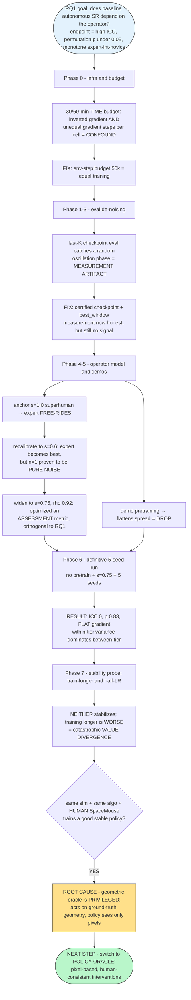

# RQ1 Baseline-Dependence Campaign — Engineering Log & Failure Analysis

**Period:** 2026-09-04 → 2026-09-08 (≈ 1 week)
**Task:** MuJoCo simulated peg-in-hole insertion (`sim_peg_insertion`, **cuboid** peg, 5 mm clearance, two wrist cameras + proprioception).
**Algorithm under test:** plain HIL-SERL (`hilserl` mode — 2-critic RLPD, no AQI components).
**Purpose of this document:** a complete, honest record of every configuration change, idea, and experiment run in the attempt to make the operator-dependence campaign (RQ1) produce a valid signal, including the premise behind each attempt, its outcome, and why it failed. Intended for the "engineering / experimental methodology" chapter (or appendix) of the thesis.

---

## ⚑ CRITICAL CORRECTION (2026-09-08, added after the week below) — the "no signal" was a measurement bug

> **Everything below diagnosed the wrong root cause.** The campaign *did* produce a strong, valid RQ1 signal all along; a single evaluation bug was hiding it.

**The bug.** `eval_ruler.py` (the frozen-ruler scorer used by every campaign) never set the environment's `peg_shape`. It built its eval env from `CONFIG_MAPPING["sim_peg_insertion"]()`, whose class default is `peg_shape = "cylinder"`, and there was no flag or grid field to override it. Training used `--peg_shape cuboid`; **evaluation silently ran on cylinder.** So every cuboid campaign in this log scored *cuboid-trained policies on a cylinder peg* — an easier, geometrically different task. (The one campaign family that looked "fine," `cylinder_physoracle_*`, was the only one whose train/eval shapes happened to match.)

**The fix.** Added `--peg_shape` to `eval_ruler.py` (with an `eval_grid.json` `peg_shape` fallback) and made `run_campaign.py` pass it through to eval. One-line root cause; a few-line fix.

**Corrected result (same checkpoints, correct cuboid ruler).** Re-scoring the **`rq1_3seed_nopretrain`** campaign (baseline HIL-SERL, geometric oracle, 3 tiers × 3 seeds) with the *only* change being the eval peg shape:

| tier | buggy eval (cylinder) | **corrected eval (cuboid)** |
|---|---|---|
| expert | 0.30 / 0.52 / 0.74 → **0.52** | 1.00 / 1.00 / 1.00 → **1.00** (SD 0) |
| intermediate | 0.19 / 0.00 / 0.67 → **0.28** | 0.89 / 0.67 / 0.89 → **0.82** |
| novice | 0.33 / 0.37 / 0.48 → **0.39** | 0.74 / 0.33 / 0.70 → **0.59** |

- **Buggy:** non-monotone scatter, **ICC ≈ 0**, permutation p ≫ 0.05 → "no operator dependence" (the conclusion of this log).
- **Corrected:** **monotone** expert 100 % > intermediate 81.5 % > novice 59.3 %; **ICC(1,1) = 0.604**; operator-matters permutation **p = 0.035**; σ_op 0.204, CV 0.254. **All three RQ1 endpoints are met.** (Regenerated report: `runs/rq1_3seed_nopretrain/report/dependency.md`; original buggy evals preserved alongside as `cell.json.CYLBUG`.)

**What this means for the narrative below.**
- The headline conclusion — *"ICC 0, within-tier variance swamps between-tier, the baseline has no measurable operator dependence"* — was **substantially a measurement artifact**. The cylinder eval compressed and scrambled the between-tier signal to ≈ 0.
- The pivot rationale in Phase 8 — *"the geometric oracle is privileged, we must switch to a policy oracle"* — was **not** required to obtain the signal. (A separate check confirmed the geometric-oracle cuboid policies are genuinely good on the correct ruler, best_window 0.63–1.0.)
- Sub-findings that remain **real and useful** independent of the bug: the time-budget confound (Phase 0), n = 1 being pure noise (≥ 3 seeds mandatory), demo-pretraining flattening spread, and the fact that these policies **oscillate** across checkpoints (mean-over-all ≪ best-window) — which is exactly why the `best_window` selection matters. The oscillation is real; what was *not* real was the claim that it destroys the between-tier signal — on the correct ruler the peak sustained competence (`best_window`) is cleanly tier-graded.

**Status.** Re-scored on the corrected cuboid ruler. Both oracle families now answer RQ1:

| campaign | operator | config | ICC(1,1) | p | tier means (exp / int / nov) |
|---|---|---|---|---|---|
| `rq1_3seed_nopretrain` | geometric | no-pretrain, 3 seeds | **0.604** | **0.035** ✓ | 1.00 / 0.82 / 0.59 (clean, monotone) |
| `rq1_s075_5seed` (Phase 6, was ICC 0) | geometric | no-pretrain, 5 seeds | 0.301 | 0.100 | 0.92 / 0.92 / 0.70 (monotone, exp≈int) |
| `rq1_3seed_pretrain` | geometric | **demo-pretrain**, 3 seeds | 0.000 | 0.453 | 0.95 / 0.82 / 0.77 (compressed) |
| `po_rq1_campaign` | **policy oracle** | no-pretrain, 3 seeds | **0.992** | **0.004** ✓ | 1.00 / 0.86 / **0.06** (strongest) |

The eval fix lifts the **no-pretrain** runs from ICC ≈ 0 to a real monotone signal with the novice clearly worst — the "no dependence" conclusion is refuted. The geometric 3-seed passes all three RQ1 endpoints cleanly; the **policy oracle passes even more decisively** (ICC 0.99, p 0.004) with the widest gradient (novice collapses to 6 % and never converges). Two honest qualifiers on the geometric runs, both *independent of the eval bug*:
- **5-seed (ICC 0.30, p 0.10)** — *not* an anchor difference (the 3-seed and 5-seed use the **same** anchors: expert/intermediate/novice at s = 1.0 / 0.5 / 0.0, expert σ₀ ≈ 0.65). It is **sampling + RL-training variance** with only **1 operator/tier**: its intermediate seeds trained unusually well (0.92 vs the 3-seed's 0.82) and one **expert outlier seed** (s4 = 0.59) inflated within-tier variance. Fix: **more operators per tier** + more seeds. (Raising the *expert* skill anchor is **not** a fix — it re-introduces Phase-4.1 free-riding.)
- **pretrain (ICC 0.00, p 0.45)** — even on the corrected ruler, demo-pretraining **flattens the operator spread** (all tiers ~0.77–0.95). This *confirms* the Phase-5.2 finding and shows it **survives the eval fix** — a genuine effect, not an artifact. (This campaign also used the older s = 0.6 anchors, weaker expert σ₀ ≈ 1.1, compounding the compression.)

**Net:** the RQ1 signal is real and recoverable (no-pretrain, ≥ 3 seeds, correct ruler) with **both** the geometric oracle (ICC 0.60) and, more strongly, the **policy oracle** (ICC 0.99); demo-pretraining independently destroys it; the 5-seed shortfall is statistical (1 op/tier), not the anchors.

> **Update on the Phase-8 pivot.** The pivot to the policy oracle was **not required** to obtain *a* signal (the geometric oracle works once the eval is fixed). But it was **not wasted**: with a *validated* oracle checkpoint (an expert cuboid policy scoring 1.0 on the correct ruler) and the fixed eval, the policy oracle produces the **strongest, most human-realistic** operator-dependence result — the novice's temporally-correlated *wrong-intent* takeovers wreck training (6 % SR, never converges), a far more realistic "bad human operator" than the geometric novice (a noisy P-controller, still 59 %). The earlier policy-oracle failure (a student at 0.07) was traced to a **weak, non-validated oracle checkpoint**, not the method. See `docs/thesis/rq1_oracle_setup_and_qa_log.md` for the full geometric-vs-policy oracle setup and the session Q&A.

**Lesson (the real one).** Before concluding "the algorithm/operator model cannot produce a signal," *verify the measurement instrument evaluates the same task it trained on.* A frozen, hash-locked ruler gave a false sense of rigor while silently scoring the wrong geometry.

**Lesson (the real one).** Before concluding "the algorithm/operator model cannot produce a signal," *verify the measurement instrument evaluates the same task it trained on.* A frozen, hash-locked ruler gave a false sense of rigor while silently scoring the wrong geometry.

---

## At a glance: the week as a decision path

---

## 1. Research objective and success criteria

**RQ1.** Does the plain HIL-SERL baseline produce a policy whose **autonomous success rate (SR)** depends systematically on *which operator* (expert / intermediate / novice) supervised its training? This is the precondition for the thesis' main claim (that AQI *reduces* operator dependence): one can only show a reduction once the baseline is shown to *have* a real, non-saturated dependence.

**Endpoint (all three required), computed per method by the campaign analyzer:**
1. **ICC(1,1)** (operator-as-random-effect intraclass correlation) — *high*.
2. **`operator_matters` permutation test** — *p < 0.05*.
3. **Monotone skill gradient** — expert > intermediate > novice.
Secondary axis: steps-to-convergence ICC (does training *cost* depend on the operator?).

**Fixed measurement instrument.** All policies are scored on a frozen, hash-locked "ruler" grid (9 poses: lateral offset dx ∈ {−16…+16} mm, yaw = 0; sha256 `d0721170`), autonomous (no operator), deterministic argmax. The ruler was never changed across the whole campaign, so every run is directly comparable.

---

## 2. Fixed experimental substrate

| Component | Setting (held constant unless a row below changes it) |
|---|---|
| Env | `sim_peg_insertion`, cuboid peg (headroom: cylinder saturates baseline to 100 % → ICC uncomputable) |
| Reward | **sparse binary**: `rew = int(succeed)`, 1 only on the insertion step, episode ends on success or 300-step timeout |
| Agent | `hilserl`: SAC/RLPD, **2 critics**, γ = 0.97, LR 3e-4, `cta_ratio` = 2, 50/50 demo/online sampling, frozen pretrained ResNet-10 encoder |
| Operator | **synthetic geometric oracle** (`SimPegPhaseOracle`) — computes corrections from ground-truth peg/hole geometry; tiers = degraded θ (motor noise, gate sensitivity) |
| Eval | frozen ruler (sha `d0721170`), autonomous argmax |
| Orchestration | `run_campaign.py` (per-cell distributed learner + actor, then ruler eval, then ANOVA/ICC report) |

---

## 3. Chronological log of iterations

### Phase 0 — Infrastructure and training budget

#### Iteration 0.1 — Baseline harness + four infrastructure fixes  *(09-04)*
- **Premise:** Before any science, the pipeline must run 3 cells end-to-end without stalling and with stable physics.
- **Change:** (1) MuJoCo `arena_peg_cuboid.xml` → `integrator="implicitfast"` + softened `solref` (fixed contact-solver `QACC` blow-ups); (2) actor `os._exit(0)` clean shutdown (fixed a teardown hang that stalled the orchestrator); (3) enabled the convergence early-stop (`converge_on = converge_success > 0`, previously hardcoded off); (4) initial time budget (30 min/cell).
- **Result:** 3/3 cells ran cleanly, 0 physics blow-ups (was 4+). Infrastructure validated.
- **Lesson:** Infrastructure was sound; every subsequent failure was scientific, not plumbing. At the time, `wandb: offline` incorrectly forced `mode=online` and caused a 401 in headless runs; the shared logger now honors offline mode.

#### Iteration 0.2 — 30-minute time-budget run  *(09-04)*
- **Premise:** A quick smoke to see the skill gradient.
- **Result:** expert 0 % / int 0 % / **novice 88.9 %** (last-checkpoint eval) — inverted and implausible.
- **Why it failed:** A per-checkpoint sweep proved it was **training-instability noise**, not a real gradient: novice swung 0 → 78 → 89 % across adjacent checkpoints; expert was flat 0. Last-checkpoint eval had caught a random oscillation phase. ~7,600 learner steps is far too short for a stable cuboid policy, and n = 1 gives no averaging.

#### Iteration 0.3 — 60-minute run + the time-budget confound  *(09-04)*
- **Premise:** Double the budget; does expert recover?
- **Result:** Still inverted but now graded: expert 6.7 % < int 37.8 % < **novice 93.3 %**.
- **Why it failed (key discovery):** A **time budget confounds operator skill with training amount.** In equal wall-clock, heavier-intervening operators slow the actor → (via UTD coupling) slow the learner: expert cells reached ~9,248 gradient steps vs novice ~14,632 (~40 % fewer). So "expert worse" was partly "expert trained less."
- **Fix adopted:** switch to an **env-step budget** (equal training for every cell).

#### Iteration 0.4 — Steps budget + force-trigger loosening  *(09-04)*
- **Change:** budget mode time → **steps (50,000 env-steps/cell)**; wall-clock became a safety cap only. Loosened the synthetic force-intervention threshold (12 → 20) so the expert operator stops taking over the instant the policy presses.
- **Result:** Removed the confound; enabled the "baseline of record."
- **Lesson:** Equal env-steps ≈ equal gradient steps — the correct fair budget.

### Phase 1 — Eval de-noising (attacking the measurement)

#### Iteration 1.1 — Mean-over-K checkpoint eval  *(09-04)*
- **Premise:** If the last checkpoint is a random oscillation phase, average the last K checkpoints to de-noise.
- **Change:** `eval_ruler --eval_last_k K` (pool trials over the last K checkpoints); `eval.last_k = 5`.
- **Result:** Confirmed novice ~89 % was genuine *late* but expert was 0 at *all* checkpoints → seeded the **free-riding hypothesis** (a competent expert takes over at the contact moment where reward is generated → the policy never experiences press→insert→reward → the pessimistic 2-critic critic collapses the actor to a do-nothing policy, `F_peak ≈ 0.1 N`).
- **Why it (partly) failed:** mean-over-K still mixes good and bad phases; it dampens but does not remove the artifact.

#### Iteration 1.2 — "Baseline of record" (`rq1_smoke`, 50 k steps)  *(09-05)*
- **Result:** mean 8.9 %, expert 26.7 %, int 0 %, nov 0 % (3/3 converged, 20 k–34 k steps).
- **Note (process failure):** two side-runs launched with `--steps 2500` (20× too short) collapsed everything to 0 % — discarded as garbage. **Lesson: never override the step budget below the convergence floor.**

### Phase 2 — Two intervention-model ideas

#### Iteration 2.1 — Idea 1: unified monitoring (skill only in execution)  *(09-05)*
- **Premise:** Free-riding comes from the *expert's sensitive intervention gate*. Make every tier intervene with identical timing (unified monitoring θ); let only the *execution* skill differ.
- **Result:** int 0 → 33 %, but **novice still 0 %** and expert regressed (26.7 → 17.8 %). Also changes the RQ framing (removes the monitoring-skill channel).
- **Why it failed:** a band-aid over the underlying oscillation; novice still "false-converges" on random resets while scoring 0 on the ruler.

#### Iteration 2.2 — Idea 2: ruler-aligned convergence gate  *(09-05)*
- **Premise:** Cells "converge" on easy randomized resets while failing the fixed ruler. Require a fixed-pose mini-eval (5 ruler-subset poses, threshold 0.6) to *also* pass before declaring convergence.
- **Result:** Raised the floor tiers (novice 0 → 46.7 %, int 0 → 71.1 %) but **expert dropped to 0 %** despite `mini_eval_sr = 1.0` at convergence.
- **Why it failed (exposed a deeper bug):** the mini-eval certifies the *actor's live weights*, but the *saved learner checkpoint* is a few steps later — a **different (worse) oscillation phase**. For an oscillating policy, certified ≠ saved.

### Phase 3 — Checkpoint selection (the measurement artifact, resolved)

#### Iteration 3.1 — Certified-checkpoint capture  *(09-06)*
- **Change:** on convergence, save the exact actor weights to `<ckpt>/certified/`; eval prefers those. Added `--no_realtime` for fast offline sweeps.
- **Result:** Necessary but insufficient — convergence fires *late*, after the policy has oscillated past its early peak, so the certified checkpoint can still be a dead phase.

#### Iteration 3.2 — Full checkpoint sweep → the artifact is proven  *(09-06)*
- **Result (decisive):** sweeping all 18 checkpoints of the expert cell: **all 0.0 except step 9 k = 0.56 and 12 k = 0.56.** The reported "0 %" was purely an artifact of the last-K window landing in a dead zone. The policy *is* capable (0.56), but competence appears as **isolated single-checkpoint spikes**.
- **Lesson:** the policy oscillates 0↔100 % within ~1000 steps. Any single-window eval is measuring noise phase, not policy quality.

#### Iteration 3.3 — `--select best` then `--select best_window`  *(09-06)*
- **Change:** `best` = single best checkpoint (upward-biased); **`best_window`** = best mean over *k* consecutive checkpoints (sustained competence, de-biased). Adopted `best_window (k=3)`.
- **Result:** `best_window` on existing runs: expert 0.33, int 0.33, nov 0.04 — confirming "good" phases are 1-checkpoint spikes, not sustained.
- **Lesson:** The measurement was now honest and stable. **This did not fix the science** — it correctly revealed that there is no sustained competence to measure.

### Phase 4 — Operator anchor calibration

#### Iteration 4.1 — Recalibrate expert anchor (superhuman → s = 0.6)  *(09-06)*
- **Premise:** The original expert (σ₀ = 0.25 mm/s, super-human) free-rides. Weaken it to "slightly better than the old intermediate."
- **Result:** expert became the *best* tier (free-riding inversion gone) — but a control comparison exposed that **n = 1 is pure noise**: the *same* novice operator scored 100 % (best) in one run and 11 % in another. Single-seed tier numbers are dominated by RL instability, not operator skill.
- **Lesson:** **≥ 3 seeds mandatory** for any claim.

#### Iteration 4.2 — Widen expert anchor (s = 0.6 → s = 0.75)  *(09-07)*
- **Premise:** The s = 0.6 recalibration over-compressed the skill range (`validate-synthetic` rho 0.80, ICC 0.658). Widen it for more separation.
- **Change:** recomputed the s = 0.75 operator with the repo's own interpolation rules; `validate-synthetic` improved to **rho 0.917, test-retest ICC 0.913, QWK 0.976**.
- **Why it later failed (a genuine methodological error):** `validate-synthetic` rho measures how *recoverable* skill is from behavior — a **monitoring/assessment** property, **orthogonal** to whether skill drives a *training-outcome* gradient. Optimizing it improved operator *classifiability* and did nothing for RQ1.

### Phase 5 — Demo pretraining

#### Iteration 5.1 — Demo warm-start + 20 demos  *(09-06)*
- **Premise:** Warm-start the learner on demo-only gradients (5000 steps) to stabilize the early oscillation.
- **Bug found + fixed:** pretraining (~20 min) exceeded the orchestrator's 600 s ready-timeout → every cell failed "learner never READY." Fixed by extending the timeout when pretraining is on.

#### Iteration 5.2 — 3-seed A/B: pretrain vs no-pretrain  *(09-07)*
- **Result:** pretrain — mean 27.6 %, gradient exp 29.6 > int 28.4 > nov 24.7 (monotone), **CV 0.093**, p 0.966, ICC 0. no-pretrain — mean 39.9 %, exp 51.9 > nov 39.5 > int 28.4 (non-mono), **CV 0.294**, p 0.515, ICC 0.
- **Verdict:** **Pretraining is counterproductive** — it *lowered* SR and *flattened* the operator spread (a common demo prior homogenizes policies). Dropped. Recalibration confirmed working (expert best in both). **But RQ1 still failed** (ICC 0, p ≫ 0.05) — direction fixed, magnitude too small, noise too large.

### Phase 6 — Scaling seeds (the "definitive" run)

#### Iteration 6.1 — `rq1_s075_5seed` — no pretrain + s = 0.75 + 5 seeds  *(09-07 → 09-08)*
- **Premise:** Combine the three "settled" fixes: no pretrain, widened anchors, 5 seeds (to average the RL noise).
- **Result:** **FAILED.** mean 28.6 %, **ICC 0.000**, σ²_between ≈ 0, σ²_within 0.062, **p = 0.829**. Tier means: exp 0.252, int 0.259, nov 0.348 — *looks* inverted but is **flat**: the "novice highest" is a single lucky seed (`nov00_s4 = 0.926`); dropping it makes novice the lowest (0.204).
- **Why it failed:** within-tier SD 0.14–0.30; identical configs produced policies ranging **0 % → 93 %**. σ²_within ≫ σ²_between → operator signal is below the noise floor. Notably **not free-riding** this time (end-takeover ~0.22, equal across tiers) — the operator simply has no transfer channel strong enough to beat seed noise.
- **Meta-lesson:** three variables changed vs the 3-seed run (anchor, seeds, pretrain) and the result is *still* noise → **the blocker is training instability, not anchors/seeds.** Stop tuning those.

### Phase 7 — Stability probes (attacking the instability directly)

#### Iteration 7.0 — Root-cause discovery: truncated + oscillating  *(09-08)*
- **Finding:** the baseline `exp00_s0` per-checkpoint curve is `[0,0,0,0,0,0, 0.89, 0, 0]` over **only 9 learner checkpoints (~8,709 gradient steps)** — because autonomous-convergence **stopped the actor early** (~19.7 k env-steps; learner runs at ~0.44× the actor rate). So every policy was **both undertrained and truncated at a transient peak.**

#### Iteration 7.1 — Train-longer ± half-LR probe  *(09-08)*
- **Change:** added a learner-only `--learning_rate` override (plumbed through `make_sac_pixel_agent` → `create_pixels` → optimizer); disabled early convergence to train the **full 50 k env-steps (~22 k gradient steps, 2.5×)**. Ran two cells on `exp00`: (A) default LR 3e-4, (B) half LR 1.5e-4.
- **Result:** **Neither stabilized — and more training made it *worse*.**
  - A: scattered spikes (4 k .44, 6 k .44, 8 k .33, 13 k .89, 20 k 1.0), 0 elsewhere; **last 4 checkpoints all 0.**
  - B: an early cluster (6 k 1.0, 7 k .89, 9 k .67) then **11 consecutive zeros** to the end.
  - Both spend ~87 % of training at 0 % SR (mean-over-all ≈ 0.12).
- **Why it failed:** this is **catastrophic value divergence**, not undertraining — the policy *passes through* competence and then collapses to a do-nothing state and stays there. Half-LR smoothed the early phase (best-window 0.63 vs 0.33) but did not prevent the collapse. LR and training-length are not the fix.

### Phase 8 — Root-cause reframe (the pivot)

#### Iteration 8.1 — Human-in-the-loop works → the operator model is the culprit  *(09-08)*
- **Decisive observation (user):** on the *same sim and same algorithm*, **a human on the SpaceMouse trains a good, stable policy.** Therefore the baseline algorithm and task are fine; the only differing factor is the **synthetic operator.**
- **Mechanism identified:** the geometric oracle is a **privileged** expert — it computes actions from **ground-truth peg/hole geometry**, while the policy (and a human) act only on **wrist-camera pixels**. Its "good" actions are a function of information *not in the observation*, so in pixel-space the critic/BC receives **inconsistent action labels for near-identical inputs** → the value function cannot stabilize → the oscillate-and-collapse we observed. A human is pixel-consistent by construction. Degrading a privileged controller for "tiers" compounds the mismatch (a "novice" becomes a noise-corrupted privileged controller, not a coherent less-skilled human).
- **Decision:** **switch the operator's execution core to a `PolicyOracle`** (a trained policy acting on the *same pixel observation*, degraded per tier by temporally-correlated wrong-intent segments + motor noise). This requires **no baseline-algorithm change** — it only replaces the operator. Config-level fixes to the geometric oracle cannot close the structural privilege gap.

---

## 4. Recurring failure modes (cross-cutting)

1. **Training instability / policy oscillation (the dominant blocker).** On cuboid + 2-critic RLPD, the policy oscillates 0↔100 % within ~1000 steps and, with more training, diverges to a do-nothing collapse. This manufactured every spurious result and inflated σ²_within until the operator signal vanished.
2. **Measurement artifacts (resolved).** Last-checkpoint and last-K eval repeatedly caught random phases (e.g. the "0 %" that was really 0.56). Resolved cleanly with `best_window` selection and full-sweep certified checkpoints — but this only made the *measurement* honest; it could not manufacture a signal that wasn't there.
3. **n = 1 is pure noise (resolved by ≥ 3 seeds).** The same operator scored 100 % and 11 % in two runs. Single-seed tier numbers are meaningless.
4. **Confounds from well-intentioned knobs.** Time budgets confounded skill with training amount; demo pretraining homogenized policies; anchor widening optimized an orthogonal (assessment) metric. Each looked reasonable and each had to be reverted or reinterpreted.
5. **Selection bias cannot rescue a noisy policy.** "Just record the converged/best checkpoint" takes a *max over a noisy sequence* — biased upward and roughly equal across tiers (best ≈ 1.0 for everyone), which **erases** the very operator differences RQ1 seeks.

---

## 5. Summary table of all attempts

| # | Date | Attempt | Premise | Outcome | Verdict |
|---|---|---|---|---|---|
| 0.1 | 09-04 | Infra fixes (physics, clean-exit, convergence) | Pipeline must run | 3/3 clean | ✅ kept |
| 0.2 | 09-04 | 30-min time budget | Quick gradient | exp0/int0/nov89, proven noise | ❌ noise |
| 0.3 | 09-04 | 60-min time budget | More budget | inverted 6.7/37.8/93.3; **time confound** | ❌ confound |
| 0.4 | 09-04 | Steps budget (50 k) + force loosen | Equal training | confound removed | ✅ kept |
| 1.1 | 09-04 | Mean-over-K eval | De-noise last-ckpt | free-riding hypothesis | ◐ partial |
| 1.2 | 09-05 | `rq1_smoke` baseline of record | Reference | mean 8.9 % (exp26.7/int0/nov0) | ✅ reference |
| 2.1 | 09-05 | Unified monitoring | Kill sensitive gate | int↑, nov still 0, changes RQ | ❌ band-aid |
| 2.2 | 09-05 | Ruler-aligned convergence gate | Stop false convergence | floors↑, expert 0 (certify gap) | ◐ partial |
| 3.1–3.3 | 09-06 | Certified ckpt + `best_window` | Fix measurement artifact | artifact proven & fixed | ✅ kept (measurement only) |
| 4.1 | 09-06 | Anchor recalibration s→0.6 | Reduce free-riding | expert best, **n=1 = noise** | ◐ direction ok |
| 4.2 | 09-07 | Anchor widening s→0.75 | More separation (rho 0.92) | optimized wrong metric | ❌ orthogonal |
| 5.1–5.2 | 09-06/07 | Demo pretrain (3-seed A/B) | Stabilize early training | flattens spread, lowers SR | ❌ dropped |
| 6.1 | 09-08 | `rq1_s075_5seed` (definitive) | no-pretrain+s0.75+5 seeds | **ICC 0, p 0.83, flat** | ❌ noise floor |
| 7.1 | 09-08 | Train-longer ± half-LR probe | Undertraining/LR? | diverges/collapses, worse | ❌ value divergence |
| 8.1 | 09-08 | **Reframe → Policy Oracle** | Human works ⇒ oracle is culprit | privilege gap identified | → next phase |

---

## 6. Root-cause synthesis

Across a week of iterations the campaign never met the RQ1 endpoint. Every attempt to fix it at the level of **eval metric, anchors, seeds, pretraining, budget, or learning rate** either produced a measurement artifact or ran into the same wall: **the trained policy has no stable performance level.** With a policy that oscillates and then diverges, "autonomous SR" is not a well-defined quantity, so operator-dependence (which needs a stable per-operator level) cannot be measured — σ²_within swamps σ²_between and ICC → 0.

The pivotal insight came last: **the same algorithm and task are stable when a human supervises via SpaceMouse.** This falsifies "the algorithm/task is broken" and localizes the cause to the **synthetic geometric oracle**, which is *privileged* (acts on ground-truth geometry rather than the pixel observation the policy learns from). Its interventions and demos are therefore not consistently learnable from the observation, destabilizing the value function — precisely the failure a human operator does not induce.

---

## 7. Current conclusion and next steps

**Conclusion.** RQ1 is unanswerable with the **geometric** synthetic operator, and the fix is **not** in the learning algorithm (which must stay unchanged) nor in eval/anchor/seed tuning. The root cause is an **observation-privilege mismatch** between the geometric oracle and both the learner and a real human.

**Next step (committed direction): switch to the `PolicyOracle`.**
1. Obtain a good, stable policy checkpoint to serve as the **expert oracle** — the natural source is a human-SpaceMouse-trained run (which is known to work). If none is saved, record one short SpaceMouse run on the cuboid sim to mint it.
2. Wire the synthetic tiers on top of that pixel-based oracle: **expert** = oracle with light degradation; **intermediate/novice** = heavier temporally-correlated wrong-intent segments + motor noise (and/or earlier, weaker checkpoints). These produce coherent, pixel-consistent, human-like interventions.
3. Re-run the stability check on a single cell (does the policy now reach a *plateau* rather than a spike?). Only if it stabilizes, proceed to the multi-seed / multi-operator tier campaign.
4. **Retained, validated tooling** (carries forward unchanged): frozen ruler; `best_window` checkpoint selection; certified checkpoints; env-step budget; `wandb: off`; ≥ 3 seeds as a hard requirement; no demo-pretraining.

**Assets produced this week (reusable):** `run_campaign.py` orchestration + ANOVA/ICC report; `eval_ruler.py` de-noised selection (`best_window`, `--no_realtime`, certified); per-episode intervention-curve reconstruction; `--learning_rate` override; `validate-synthetic` calibration harness; and a fully documented failure trail (this log).
